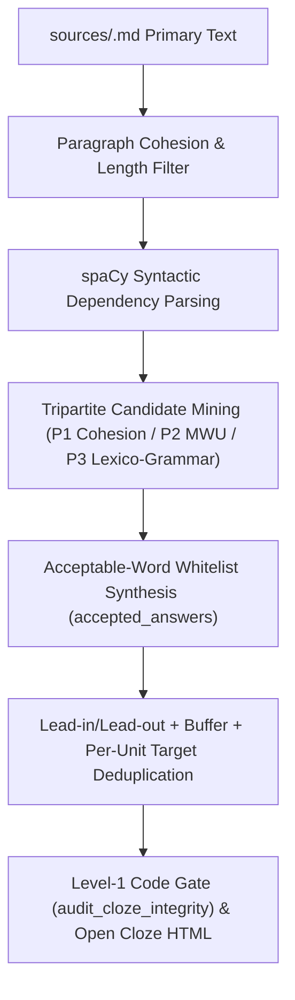
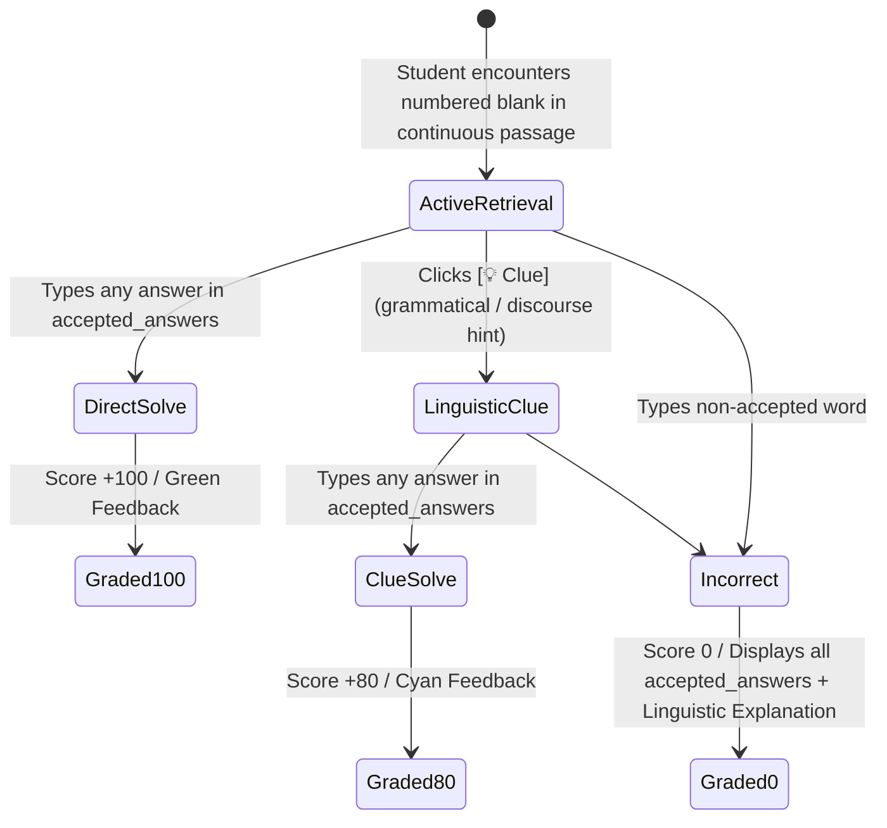

# Discourse Cloze Architecture: Pure Open Cloze & Acceptable-Word Scoring

> **Purpose**: Technical specification and applied testing standard for the Lexis Wiki **Discourse Cloze** module (`librarian/linguistics_core/quiz_cloze.py`). Implements an authentic, zero-token discourse-level assessment engine modeled on Cambridge *Reading and Use of English Part 2 (Pure Open Cloze)*—completely decoupled from `vocabulary_quiz` syllabus lists and 4-option MCQ distractors, focusing strictly on **discourse cohesion, bound collocations, and lexico-grammar** with **Acceptable-Word Scoring (`accepted_answers`)**.

---

## 1. Pedagogical & Psychometric Foundations

### 1.1 Strict Decoupling: Vocabulary Quiz vs. Pure Open Cloze
| Dimension | Vocabulary Quiz (`vocabulary_quiz.html`) | Pure Open Cloze (`cloze_quiz.html`) |
| :--- | :--- | :--- |
| **Testing Target** | Micro-valency & lexical semantics (single headword/sense). | Macro-cohesion, bound collocations, and lexico-grammar operators. |
| **Textual Scope** | Isolated, pre-selected 5-source LDOCE authentic sentences. | Authentic continuous paragraph(s) from `sources/<Unit>.md`. |
| **Syllabus Constraint** | Strictly gated to verified `extractions/<Unit>_vocabulary.md`. | **Non-restricted**: organic synthesis of grammar, discourse, and collocation. |
| **Response Format** | 4-option multiple choice (zero-collision distractors). | **Pure Open Cloze** (`mode: "open_cloze"`, `options: []`, typed active retrieval). |
| **Scoring Paradigm** | Single unique option index (`correct_answer_index`). | **Acceptable-Word Scoring** (`accepted_answers` whitelist, case-insensitive). |
| **LLM Token Cost** | Controlled stem crafting / precomputed blueprints. | **Absolute Zero (0 Tokens)**: deterministic `spaCy` parsing + `pedlex.db`. |

### 1.2 The Three Invariants of Discourse Testing (Alderson, 2000)
1. **Lead-in & Lead-out Invariant**:
   - The opening sentence (topic schema) and the closing sentence (rhetorical coda) of the selected discourse span **must remain 100% unblanked**.
   - *Rationale*: Eliminates cold-start cognitive overload and ensures baseline mental model construction before encountering lexical voids.
2. **Buffer Invariant (Minimum Inter-Blank Distance)**:
   - A minimum running-token buffer separates any two blanks (`>= 10` tokens in strict pass; relaxed gracefully only if needed to reach target count while preserving syntactic independence).
   - *Rationale*: Prevents cascading errors where failure to resolve blank $N$ starves blank $N+1$ of its syntactic complement.
3. **Exact Offset & Zero-Duplicate Invariant**:
   - Each blank is sliced using exact character offsets (`char_start - sent_char_start`), preventing false replacement of earlier homographs (e.g., an earlier `in` or `to` in the same sentence).
   - Per-unit `seen_targets` deduplication enforces zero duplicate target words across blanks within a unit.

---

## 2. Text Selection & Segmentation Pipeline (0 Tokens)



### 2.1 Paragraph Fitness Scoring
The system deterministically scores continuous paragraphs in `sources/<Unit>.md` by length fitness, connective density, and valency density, combining adjacent short paragraphs when needed and excluding headers, bullet lists, and short fragments.

---

## 3. Tripartite Blanking Taxonomy (三足鼎立设空体系)

Pure Open Cloze draws blanks across three balanced linguistic pillars (verified across 30 textbook units, 295 blanks: **P1 = 29.2%, P2 = 42.7%, P3 = 28.1%**):

```text
┌────────────────────────────────────────────────────────────────────────┐
│              Pure Open Cloze Tripartite Allocation (30 Units)          │
├────────────────────────┬───────────────────────┬───────────────────────┤
│ Pillar 1: Discourse    │ Pillar 2: MWU Valency │ Pillar 3: Lexico-     │
│ Cohesion & Linkers     │ & Preposition Slicing │ Grammar Operators     │
│ (29.2% / 86 blanks)    │ (42.7% / 126 blanks)  │ (28.1% / 83 blanks)   │
└────────────────────────┴───────────────────────┴───────────────────────┘
```

### 3.1 Pillar 1: Discourse Cohesion & Rhetorical Linkers (~30%)
Tests comprehension of narrative progression, cause-and-effect, and inter-clausal relations:
- **Subordinating Conjunctions**: `although`, `whereas`, `while`, `unless`, `since`, `because`, `whether`, etc.
- **Coordinating & Correlative Linkers**: `neither...nor`, `not only...but`, `both...and`.
- **Relative Pronouns & Adverbs**: Non-restrictive `which` (comma-gated), restrictive `that`/`which`, possessive `whose`, locative `where`, object `whom`.
- **Discourse Transitions**: Fronted adverbs (`however`, `therefore`, `furthermore`, `nevertheless`).

### 3.2 Pillar 2: Multi-Word Unit Valency & Half-Slicing (~40%)
Grounded in `docs/multi-word-units-slicing-and-distractor-architecture.md`:
- **Prepositional Government**: Blanks the bound preposition following a verb, adjective, or noun (`insight [into]`, `curious [about]`, `reliance [on]`).
- **Phrasal Verb Particles**: Blanks the directional/aspectual particle while preserving the lexical verb (`shut [down]`, `carry [out]`, `turn [up]`).
- **Light Verb & Delexical Collocations**: Blanks the governing operative verb (`[cast] doubt on`, `[strike] a balance`, `[pay] tribute to`).
- **Set Phrase Connectors**: Blanks the salient noun/particle in compound prepositions (`in [terms] of`, `on the [verge] of`, `by [means] of`).

### 3.3 Pillar 3: Lexico-Grammar & Functional Operators (~30%)
Tests syntactic parsing, agreement, and closed-class grammatical competence:
- **Quantifiers & Determiners**: `another`, `other`, `each`, `every`, `neither`, `much`, `many`, `few`, `little`, `several`, `enough`.
- **Aspectual, Passive & Periphrastic Auxiliaries**: `have`/`has`/`had`, `been`, `being`, `do`/`does`/`did`.
- **Modals & Semi-Modals**: `would`, `could`, `should`, `might`, `must`, `used`.
- **Reflexive & Anaphoric Reference**: `himself`, `herself`, `themselves`, `itself`, `ourselves`.
- **Comparative & Degree Operators**: `than`, `as`, `more`, `most`, `less`, `too`, `so`, `such`.

---

## 4. Pure Open Cloze Interaction & Acceptable-Word Scoring

Rather than forcing brittle 4-option distractors onto open discourse slots (which frequently introduces artificial double-key ambiguity), Pure Open Cloze uses **2-tier cognitive scaffolding** paired with **Acceptable-Word Scoring**:



### 4.1 Acceptable-Word Scoring (`_build_accepted_answers`)
- Every `DiscourseClozeBlank` stores:
  - `target_word`: canonical lowercase form;
  - `raw_word`: verbatim surface form from the source passage;
  - `accepted_answers`: list of valid, contextually licensed words (e.g., restrictive `that`/`which`, discourse near-equivalents such as `although`/`though`, while strictly blocking `that` in comma-preceded non-restrictive `, which` clauses).
  - `options: []` and `correct_answer_index: None` (`mode: "open_cloze"`).
- Client-side grading in `librarian/templates/cloze.html` normalizes whitespace/case and checks membership in `accepted_answers`, showing all accepted alternatives when the learner's response does not match.

---

## 5. Level-1 Code Gate & Verified Corpus Metrics

### 5.1 Deterministic Level-1 Gate (`audit_cloze_integrity`)
Located in `librarian/processor_core/quiz_integrity_gates.py`, `audit_cloze_integrity` verifies in `<5ms` (0 tokens):
- Verbatim grounding of masked sentences against the selected discourse span;
- Exact `[idx]` blank marker alignment;
- Non-empty `accepted_answers` containing the normalized target word;
- Zero duplicate `target_word` across blanks within the unit;
- Backward-compatible MCQ branch for legacy Mode B JSON payloads if `options` is non-empty.

### 5.2 Full-Corpus Audit Baseline (`tests/audit_cloze.py`)
Verified across **30 textbook units (`295 blanks`)**:
- **L1 Code Gate Defect Units**: `0/30` (`100%` pass rate)
- **Units with Duplicate Targets**: `0/30` (`0` duplicate blanks)
- **Exact Char-Offset Mismatches**: `0`
- **Multi-Answer Blanks (`len(accepted_answers) > 1`)**: `37/295` (`12.5%`)
- **Pillar Distribution**: `P1 = 86 (29.2%)`, `P2 = 126 (42.7%)`, `P3 = 83 (28.1%)`

---

## 6. Delivery Standard

- **Deliverable**: `wiki/<UnitName>/handouts/<UnitName>_cloze_quiz.html` (standalone single-file interactive HTML handout; omits `[⚅]` 4-option fallback button when `options` is empty).
- **Keyboard Automaticity**: `Tab` advances across inline blanks; `Enter` submits and grades immediately against `accepted_answers`.
