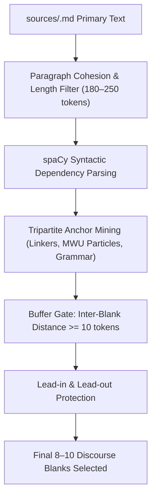
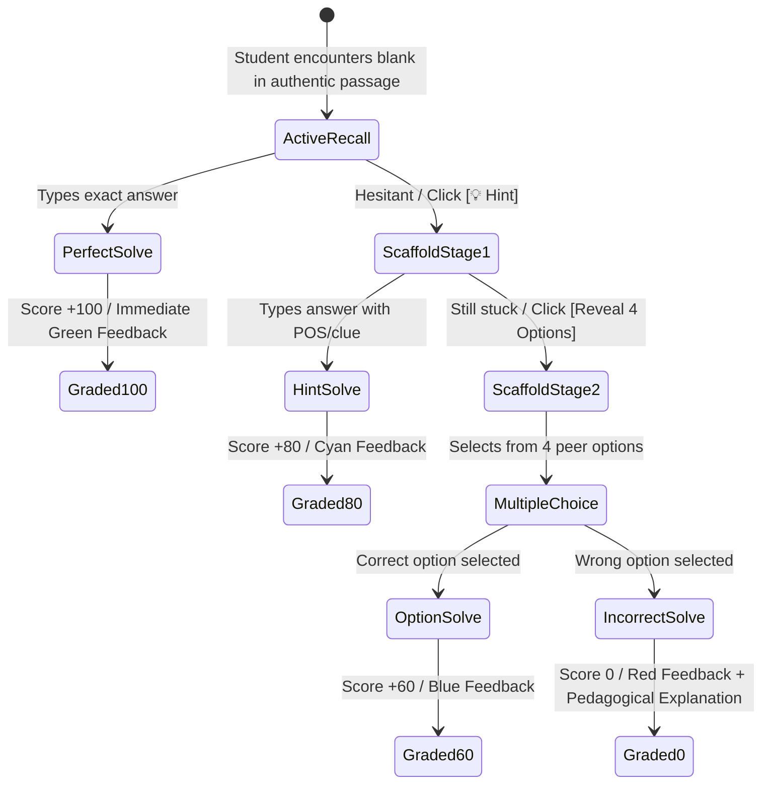

# Discourse Cloze Architecture: Progressive Scaffolding & Lexico-Grammar Integration (Mode B)

> **Purpose**: Technical specification and applied testing standard for the Lexis Wiki **Discourse Cloze** module. Replaces legacy sentence-level cloze variants with an authentic, discourse-level assessment engine modeled on Cambridge *Reading and Use of English Part 2 (Open Cloze)*, psychometrically audited paragraph selection, and progressive scaffolding (Mode B: Active Retrieval $\rightarrow$ Fallback 4-Option Resolution).

---

## 1. Pedagogical & Psychometric Foundations

### 1.1 Decoupling: Vocabulary Quiz vs. Discourse Cloze
| Dimension | Vocabulary Quiz (`vocabulary_quiz.html`) | Discourse Cloze (`cloze_quiz.html`) |
| :--- | :--- | :--- |
| **Testing Target** | Micro-valency & lexical semantics (single headword/sense). | Macro-cohesion, discourse relations, and lexico-grammar. |
| **Textual Scope** | Isolated, pre-selected 5-source LDOCE authentic sentences. | Authentic continuous paragraph(s) from `sources/<Unit>.md`. |
| **Syllabus Constraint** | Strictly gated to verified `extractions/<Unit>_vocabulary.md`. | **Non-restricted**: organic synthesis of grammar, discourse, and vocabulary. |
| **Cognitive Operation** | Paradigmatic selection against distractors. | Syntagmatic retrieval and discourse schema tracking. |
| **LLM Token Cost** | Zero (prompt-guided JSON stem crafting) or precomputed. | **Absolute Zero (0 Tokens)**: deterministic spaCy parsing + PedLex. |

### 1.2 The Three Invariants of Discourse Testing (Alderson, 2000)
1. **Lead-in & Lead-out Invariant**:
   - The opening sentence (topic schema) and the closing sentence (rhetorical coda) of the selected discourse span **must remain 100% unblanked**.
   - *Rationale*: Eliminates cold-start cognitive overload; ensures baseline mental model construction before encountering lexical voids.
2. **Buffer Invariant (Minimum Inter-Blank Distance)**:
   - A minimum of **10–15 running tokens** must separate any two blanks.
   - *Rationale*: Prevents cascading errors where failure to resolve blank $N$ starves blank $N+1$ of its syntactic complement.
3. **Deterministic Single-Fit Invariant**:
   - Every blanked item must possess either:
     - A strictly unique closed-class grammatical solution (e.g., prepositional government `insight into`, relative pronoun `which`), OR
     - A strictly controlled 4-option peer set pre-screened against double-key collisions.

---

## 2. Text Selection & Segmentation Pipeline (0 Tokens)



### 2.1 Paragraph Fitness Scoring
The system deterministically scores all continuous paragraphs in `sources/<Unit>.md`:
$$\text{Score}(P) = w_{\text{len}} \cdot \text{LengthFit}(P) + w_{\text{conn}} \cdot \text{ConnectiveDensity}(P) + w_{\text{prep}} \cdot \text{ValencyDensity}(P)$$
- **Length Gate**: Paragraphs must span **180–260 tokens** (combines two adjacent paragraphs if an individual paragraph has $<140$ tokens).
- **Exclusion Filters**: Excludes headers, bullet lists, isolated dialogue tags, and short fragments.

---

## 3. Tripartite Blanking Taxonomy (三足鼎立设空体系)

Discourse Cloze liberates assessment from artificial syllabus boundaries by drawing blanks from three psychometrically balanced linguistic pillars:

```text
┌────────────────────────────────────────────────────────────────────────┐
│                   Discourse Cloze Tripartite Allocation                 │
├────────────────────────┬───────────────────────┬───────────────────────┤
│ Pillar 1: Discourse    │ Pillar 2: MWU Valency │ Pillar 3: Grammar &   │
│ Cohesion & Linkers     │ & Preposition Slicing │ Inflectional Aspect   │
│ (~30% of blanks)       │ (~40% of blanks)      │ (~30% of blanks)      │
└────────────────────────┴───────────────────────┴───────────────────────┘
```

### 3.1 Pillar 1: Discourse Cohesion & Rhetorical Linkers (~30%)
Tests comprehension of narrative progression, cause-and-effect, and inter-clausal relations:
- **Subordinating Conjunctions**: `although`, `whereas`, `while`, `unless`, `since`, `so that`, `in order that`.
- **Coordinating & Correlative Linkers**: `neither...nor`, `not only...but`, `both...and`.
- **Relative Pronouns & Adverbs**: Non-restrictive `which`, possessive `whose`, locative `where`, object `whom`.
- **Discourse Transitions**: Fronted adverbs (`however`, `therefore`, `furthermore`, `nevertheless`).

### 3.2 Pillar 2: Multi-Word Unit Valency & Half-Slicing (~40%)
Grounded in `docs/multi-word-units-slicing-and-distractor-architecture.md`:
- **Prepositional Government**: Blanks the bound preposition following an adjective or noun:
  - `insight [into]`, `curious [about]`, `a danger [to]`, `reliance [on]`.
- **Phrasal Verb Particles**: Blanks the directional/aspectual particle while preserving the lexical verb:
  - `shut [down]`, `carry [out]`, `turn [up]`, `give [in] to`.
- **Light Verb & Delexical Collocations**: Blanks the governing operative verb:
  - `[cast] doubt on`, `[strike] a balance`, `[pay] tribute to`, `[take] steps to`.
- **Set Phrase Connectors**: Blanks the salient noun/particle in compound prepositions:
  - `in [terms] of`, `on the [verge] of`, `by [means] of`.

### 3.3 Pillar 3: Lexico-Grammar & Inflectional Form (~30%)
Tests syntactic parsing and morphological agreement:
- **Pronominal & Quantifier Reference**: `another`, `other`, `each`, `every`, `neither`, `former`, `latter`.
- **Determiners & Countability Probes**: `much`, `many`, `few`, `little`, `several`.
- **Non-Finite Verbal Aspect**: Auxiliary and non-finite verb inflections (`having done`, `being treated`, `to do`).
- **Modal Counterfactuals & Inversion Triggers**: `should have`, `used to`, `scarcely had`.

---

## 4. Mode B: Progressive Scaffolding & Interaction Mechanics

Mode B embodies the cognitive **Retrieval Practice Effect** by prioritizing active recall before offering supportive recognition scaffolding.



### 4.1 Input & Verification Logic
1. **Case-Insensitive Exact Match**: Strips whitespace and normalizes smart quotes/hyphens (`self-confidence` == `self confidence`).
2. **Inflection Parity**: For open-cloze typing, accepted keys include contracted/expanded forms (e.g., `does not` / `doesn't`).
3. **Deterministic Distractor Fallback (Stage 2)**:
   - If the student requests the 4-option fallback, distractors are served from pre-indexed closed-class tables:
     - Relative pronouns: `[which, that, where, what]`
     - Prepositions: `[for, of, to, in]` (gated against double-key valency)
     - Linkers: `[although, because, unless, despite]`

---

## 5. Architectural Implementation Pipeline

### 5.1 Symbolic Extraction via spaCy Dependency Parsing
```python
# Pure symbolic pipeline (<5ms execution, 0 LLM tokens)
def extract_discourse_cloze_candidates(doc: spacy.tokens.Doc) -> List[ClozeCandidate]:
    candidates = []
    for tok in doc:
        # Pillar 1: Subordinating / Relative / Discourse markers
        if tok.dep_ == "mark" and tok.text.lower() in DISCOURSE_CONJUNCTIONS:
            candidates.append(ClozeCandidate(token=tok, pillar=1, category="conjunction"))
        elif tok.tag_ in ("WDT", "WP", "WP$") and tok.dep_ in ("nsubj", "dobj", "pobj"):
            candidates.append(ClozeCandidate(token=tok, pillar=1, category="relative_pronoun"))
        # Pillar 2: MWU particles & bound prepositions
        elif tok.dep_ == "prt" and tok.head.pos_ == "VERB":
            candidates.append(ClozeCandidate(token=tok, pillar=2, category="phrasal_particle"))
        elif tok.dep_ == "prep" and tok.head.pos_ in ("NOUN", "ADJ") and is_bound_valency(tok.head, tok.text):
            candidates.append(ClozeCandidate(token=tok, pillar=2, category="bound_preposition"))
        # Pillar 3: Quantifiers & modal auxiliaries
        elif tok.pos_ == "DET" and tok.text.lower() in CLOSED_QUANTIFIERS:
            candidates.append(ClozeCandidate(token=tok, pillar=3, category="quantifier"))
    return enforce_buffer_and_leadin_constraints(candidates)
```

### 5.2 HTML Handout Presentation (`cloze_quiz.html`)
- **Passage-Centric Layout**: Flowing multi-paragraph reading card with styled inline input boxes.
- **Micro-Controls per Blank**:
  - `[Input Field]`: Auto-adjusts width to target word length.
  - `[💡]`: Pops a floating tooltip with grammatical category hint.
  - `[⚅]`: Expands a 4-option radio dropdown under the active line.
- **Keyboard Automaticity**: Pressing `Tab` jumps to the next blank; pressing `Enter` submits and grades.

---

## 6. Summary & Delivery Standards

- **Deliverable**: `wiki/<UnitName>/handouts/<UnitName>_cloze_quiz.html`
- **Audit Verification**: Evaluated under Level-1 Deterministic Code Gate (verbatim quotation match, single-fit verification, CRC32 slot assignment) with full support for Level-2 blind solver QA.
