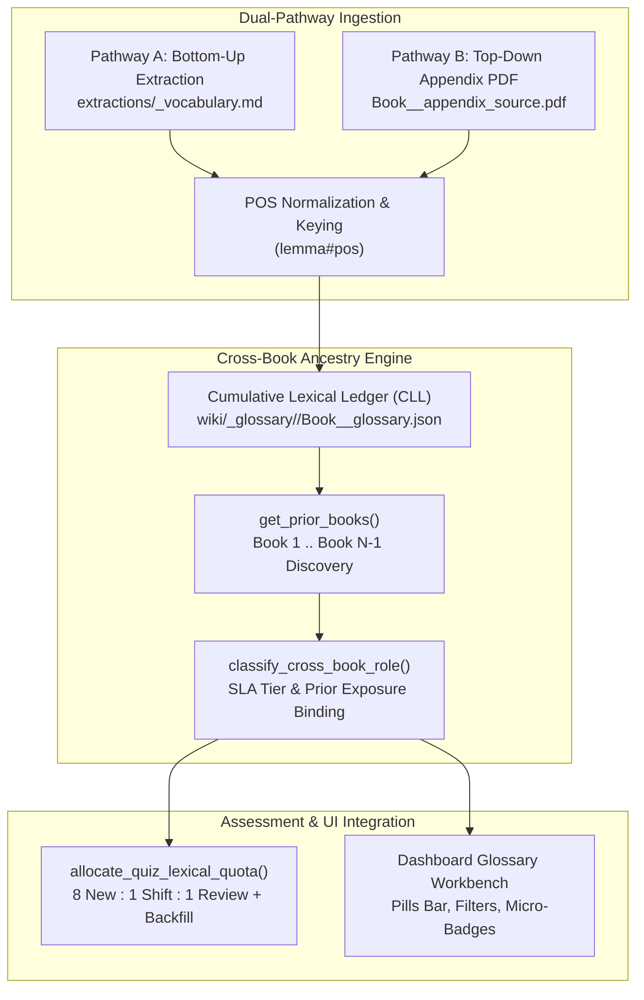

# Cumulative Lexical Ledger & Cross-Book Ancestry Architecture

> **Purpose**: Technical specification and applied Second Language Acquisition (SLA) standard for the Lexis Wiki **Cumulative Lexical Ledger (CLL)** and **Cross-Book Lexical Ancestry Engine** (`librarian/glossary_ledger.py`, `librarian/dashboard.py`, `librarian/static/js/dashboard.js`). Implements deterministic curriculum-scale vocabulary timelines, dual-pathway syllabus synchronization, cross-book sense shift tracking, and psychometrically calibrated quiz quota governance.

---

## 1. Pedagogical & Psychometric Foundations

### 1.1 The Multi-Book Island Problem in Traditional NLP
Traditional RAG and LLM educational generators treat textbook units and curriculum volumes as isolated textual silos. In a multi-book university curriculum (e.g., Books 1–4 of *New Horizon College English* or *New Practical English*), this isolation causes three severe pedagogical breakdowns:
1. **Blind Re-Introduction**: Later units re-introduce high-frequency words as "new targets" without awareness that students mastered them in earlier volumes.
2. **Polysemous Stagnation**: Words that shift part of speech or register across levels (e.g., *schedule* introduced as a concrete noun in Book 1, then functioning as an ergative/transitive verb in Book 2) are not recognized as grammatical recategorizations, forfeiting high-value SLA consciousness-raising opportunities.
3. **Example Sentence Collision**: Assessment generators draw the same canonical dictionary example sentence for quizzes across different units, degrading test reliability and student engagement.

### 1.2 Second Language Acquisition (SLA) Spiral Progression Model
Following Bruner's (1960) spiral curriculum, Nation's (2001) lexical frequency bands, and Schmitt's (2008) multi-component vocabulary depth framework, vocabulary acquisition across curriculum volumes must follow a **Tripartite Acquisition Hierarchy**:

```text
┌────────────────────────────────────────────────────────────────────────┐
│            SLA Spiral Progression Tripartite Allocation (10-Item Quiz) │
├────────────────────────┬───────────────────────┬───────────────────────┤
│ Tier 1: Target New     │ Tier 2: Sense Shift   │ Tier 3: Spaced Review │
│ Primary Acquisition    │ Polysemy / POS Shift  │ Retrieval Practice    │
│ (~80%–85% / 8 items)   │ (~10%–15% / 1–2 items)│ (~0%–5% / 0–1 item)   │
└────────────────────────┴───────────────────────┴───────────────────────┘
```

1. **Target New (`target_new`) — Core Foundation (80%–85%)**:
   - Completely unencountered lemma in prior curriculum volumes.
   - Primary cognitive focus for initial form-meaning-valency mapping.
2. **Recycled Sense Shift (`recycled_sense_shift`) — Auxiliary Deepening (10%–15%)**:
   - Lemma was encountered in an earlier book, but exhibits **part-of-speech recategorization** (e.g. noun $\rightarrow$ verb) or **domain sense extension** (e.g. physical spatial $\rightarrow$ metaphorical abstract).
   - Teaches students semantic flexibility and derivational productivity.
3. **Recycled Spaced Review (`recycled_spaced_review`) — Auxiliary Consolidation (0%–5%)**:
   - Lemma was encountered in an earlier volume with the same part of speech and primary definition.
   - Provides spaced retrieval practice to arrest Ebbinghaus memory decay without crowding out new acquisition targets.

---

## 2. System Architecture & Dual-Pathway Synchronization



### 2.1 Deterministic Storage Layout
Every textbook series and book maintains an isolated, git-stable JSON ledger under `wiki/_glossary/`:
```text
wiki/_glossary/<Normalized_Series_Slug>/
├── Book_1_appendix_source.pdf      # Optional official appendix source
├── Book_1_glossary.json            # Cumulative Lexical Ledger for Book 1
├── Book_2_glossary.json            # Cumulative Lexical Ledger for Book 2
└── Book_3_glossary.json            # Cumulative Lexical Ledger for Book 3
```

### 2.2 Dual Ingestion Pathways
1. **Pathway A: Bottom-Up Auto-Harvesting (`sync_bottom_up`)**:
   - Scans `extractions/<Unit>_vocabulary.md` across all units matching the ledger's series and book in pedagogical sequence.
   - Harvests headwords, POS, CEFR level, definitions, authentic examples, and initial exposure units.
2. **Pathway B: Official Appendix Syllabus Ingestion (`import_pdf_glossary`)**:
   - Parses official publisher appendix vocabulary PDFs via `pymupdf`.
   - Strips IPA notations, normalizes raw POS (`a.` $\rightarrow$ `adj`, `v.` $\rightarrow$ `verb`), extracts bilingual definitions, and resolves publisher unit codes (`U1P1` $\rightarrow$ `Book_1_Unit_1_Passage_A`).
   - Browser-native binary stream upload via `<input type="file" accept=".pdf">` without requiring server-side path typing.

---

## 3. Data Integrity & Normalization Invariants

### 3.1 Canonical POS Normalization (`normalize_pos`)
Raw POS strings from disparate sources are mapped to standardized grammatical keys before hashing or dictionary lookup:
```python
mapping = {
    "n": "noun", "noun": "noun", "n.": "noun",
    "v": "verb", "vt": "verb", "vi": "verb", "verb": "verb", "v.": "verb",
    "a": "adj", "adj": "adj", "adjective": "adj", "a.": "adj",
    "ad": "adv", "adv": "adv", "adverb": "adv", "ad.": "adv",
    "prep": "prep", "preposition": "prep",
    "conj": "conj", "conjunction": "conj",
    "pron": "pron", "pronoun": "pron",
    "num": "num", "numeral": "num",
    "int": "interj", "interj": "interj",
    "art": "art", "article": "art"
}
```

### 3.2 Compound Primary Keying & Homograph Separation
- **Key Schema**: `f"{norm_lemma}#{norm_pos}"` (e.g. `schedule#noun` vs `schedule#verb`).
- **Homograph Preservation**: Genuinely polysemous homographs across distinct word classes (`pat` v/n, `volunteer` n/v, `spanish` n/adj) maintain independent ledger records with distinct first-exposure units and distinct authentic examples.
- **Variant Deduplication**: Prevents duplicate entries caused by orthographic variations (`ancient#adj` vs `ancient#adjective`).

### 3.3 Example Fingerprint Collision Guard (`hash_example_text`)
Authentic sentences used in unit extractions and quizzes are indexed via a normalized SHA-256 fingerprint:
```python
def hash_example_text(text: str) -> str:
    norm = text.strip().lower()
    norm = re.sub(r"[\-_]+", " ", norm)
    norm = re.sub(r"[^\w\s]", "", norm)
    norm = re.sub(r"\s+", " ", norm).strip()
    return hashlib.sha256(norm.encode("utf-8")).hexdigest()[:12]
```
`is_example_used(example_text)` ensures that no two quiz items across the entire curriculum volume ever reuse the same example sentence.

---

## 4. Cross-Book Ancestry & Lexical Role Classification

### 4.1 Ascending Ancestry Chain Traversal (`get_prior_books` & `load_prior_ledgers`)
When examining Book $K$ ($K > 1$), the ledger deterministically discovers all strictly earlier volumes in the same series:
$$\text{Ancestry}(K) = \{b \in \mathbb{N} \mid 1 \le b < K \land \text{Book}_b\text{\_glossary.json exists}\}$$

### 4.2 Tripartite Classification Algorithm (`classify_cross_book_role`)
For each word candidate $(\text{lemma}, \text{pos})$ in Book $K$:
1. Search all prior ledgers $\{L_1, \dots, L_{K-1}\}$ for matching occurrences of $\text{lemma}$.
2. **Case 1: No matches in any prior ledger**:
   $$\text{tier} \leftarrow \text{"target\_new"},\quad \text{prior\_exposure} \leftarrow \text{None}$$
3. **Case 2: Prior matches found, but none share the same normalized POS**:
   $$\text{tier} \leftarrow \text{"recycled\_sense\_shift"},\quad \text{prior\_exposure} \leftarrow \{ \text{book}, \text{unit}, \text{pos}, \text{note} \}$$
   *(e.g., Book 1 introduced noun $\rightarrow$ Book 2 introduces verb)*.
4. **Case 3: Prior match found with identical POS**:
   $$\text{tier} \leftarrow \text{"recycled\_spaced\_review"},\quad \text{prior\_exposure} \leftarrow \{ \text{book}, \text{unit}, \text{pos}, \text{note} \}$$

---

## 5. Psychometric Quiz Quota Governor (`allocate_quiz_lexical_quota`)

### 5.1 Quota Specification
For a standard 10-item Vocabulary Assessment:
- **`target_new`**: $\max(1, \text{round}(10 \times 0.80)) = 8$ items
- **`recycled_sense_shift`**: $\text{round}(10 \times 0.15) = 1$–$2$ items
- **`recycled_spaced_review`**: $10 - \text{new} - \text{shift} = 0$–$1$ item

### 5.2 Graceful Backfilling Invariant
In university textbooks, vocabulary target lists across successive volumes are often strictly disjoint (e.g. *New Horizon College English* Books 1 and 2 Section A lists have 0 overlapping lemmas). 

If a unit's candidate pool contains fewer sense shift or spaced review items than the target quota:
$$\text{allocated\_shifts} = \min(\text{quota}_{\text{shift}}, |\text{candidates}_{\text{shift}}|)$$
$$\text{allocated\_reviews} = \min(\text{quota}_{\text{review}}, |\text{candidates}_{\text{review}}|)$$
$$\text{needed\_new} = \text{total\_count} - \text{allocated\_shifts} - \text{allocated\_reviews}$$
$$\text{selected} = \text{candidates}_{\text{shift}}[:\text{allocated\_shifts}] \cup \text{candidates}_{\text{review}}[:\text{allocated\_reviews}] \cup \text{candidates}_{\text{new}}[:\text{needed\_new}]$$

If all auxiliary tiers are completely empty, the system gracefully backfills 100% with `target_new` candidates without throwing exceptions, generating synthetic fillers, or producing short quizzes.

---

## 6. Dashboard Workbench & UI Integration

### 6.1 Modal Summary Bar
In `#book-glossary-modal`, alongside the CEFR breakdown, the stats summary bar renders SLA Progression pills:
- `⭐ New: X (85%)` (Green pill, `bg-success-subtle text-success`)
- `🔀 Shift: Y (12%)` (Yellow pill, `bg-warning-subtle text-warning`)
- `🕒 Review: Z (3%)` (Cyan pill, `bg-info-subtle text-info`)

### 6.2 Multi-Tier Filter Controls
The search and filter bar features a dedicated tier selector:
```html
<select id="glossary-tier-filter" onchange="filterGlossaryEntries()">
    <option value="all">All Tiers</option>
    <option value="target_new">New Words (80%+)</option>
    <option value="recycled_sense_shift">Sense Shift (10-15%)</option>
    <option value="recycled_spaced_review">Spaced Review (0-5%)</option>
</select>
```

### 6.3 Table Micro-Badges
In the glossary table, non-new entries display micro-badges indicating their pedagogical origin:
- `[Shift · B1]`: Recategorized or sense-shifted word originating from Book 1.
- `[Review · B1]`: Spaced review word re-activated from Book 1.

---

## 7. Verification & Production Audits

### 7.1 Production Dataset Baseline
Audited across real curriculum datasets:
- **New Practical English · Book 1**:
  - Total entries: 476
  - Unique lemmas: 472
  - Genuine homographs: 4 (`pat` v/n, `spanish` n/adj, `schedule` v/n, `volunteer` n/v)
  - Duplicate anomalies: 0
- **New Horizon College English (Fourth Edition) · Book 2**:
  - Total entries: 148 across 6 Section A units
  - Unique lemmas: 148
  - Metadata completeness: 100% with valid lemma, POS, first unit, definition, and authentic examples.

### 7.2 Automated Test Suite (`tests/test_glossary_deduplication.py`)
All invariants are audited under automated CI tests:
- `test_pos_normalization_prevents_duplicate_keys`: Verifies `adj` / `adjective` canonical convergence.
- `test_example_hash_deduplication`: Validates punctuation-invariant example hashing.
- `test_cross_unit_prior_target_detection`: Confirms early-unit target protection in later units.
- `test_cross_book_ancestry_discovery`: Verifies ascending prior book traversal.
- `test_cross_book_role_classification`: Verifies `target_new`, `recycled_sense_shift`, and `recycled_spaced_review` arbitration.
- `test_quiz_lexical_quota_governor`: Tests 8:1:1 quota allocation and 100% graceful backfilling.
- `test_summary_includes_acquisition_tier_breakdown`: Validates API serialization.
