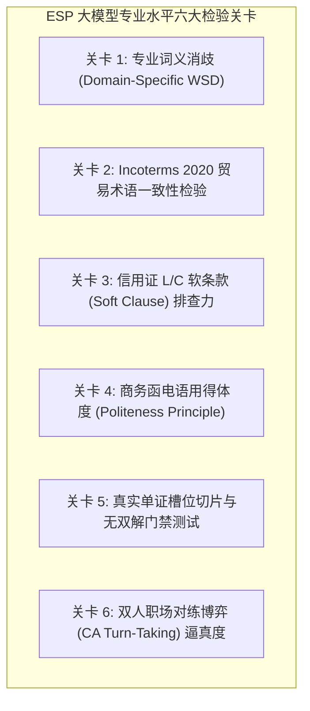
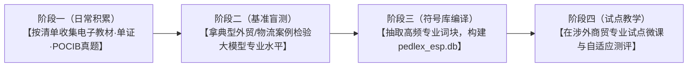

# 外贸与国际物流专业英语（ESP）拓展指南：资料收集清单与模型检验规范

> **文档定位**：本项目面向行业专门用途英语（ESP，重点覆盖外贸英语、国际物流英语、跨境电商英语）的长期技术路线储备文档。用于指导日常语料资料的定向收集、专业词库构建以及大语言模型专业外语水平的系统性基准检验（Benchmark Validation）。

---

## 1. 为什么 ESP 需要单独的语料与验证体系？

通用英语（EGP，如《新视野大学英语》）聚焦通识词块与修辞；而**外贸与国际物流专业英语（ESP）是“语言表达与商业法理、业务工作流、国际惯例强耦合”的领域**：
1. **语义特化**：通用高频词在专业语境中词义发生颠覆（如 `draft`=汇票、`vessel`=远洋货轮、`carriage`=运费、`clean`=清洁提单、`average`=海损）；
2. **规则硬约束**：选项与例句必须严格符合国际商会《国际贸易术语解释通则》（**Incoterms 2020**）及《跟单信用证统一惯例》（**UCP 600**），稍有不慎即成教学教学事故或产生多重争议解；
3. **文书与单证依存**：核心考点不在孤立长难句，而在国际海运提单（B/L）、信用证（L/C）、商业发票（Invoice）的字段合规性与真实商务往来函电（Emails）。

---

## 2. 资料收集与整理清单（教师收集指南）

华老师及课题组在日常教学、教研交流或网上浏览时，可留意收集以下 5 大维度的资料（格式不限：PDF、Word、扫描图片、网页文本均可），统一归档至本地目录备用（建议路径：`E:\ESP_Materials\` 或直接导入项目 `sources/esp_raw/`）：

### 2.1 经典教材与电子讲义（权威母本）
* **外贸函电类**：
  * 《外贸英语函电》（推荐版本：对外经济贸易大学 王关富/尹小玲版、高等教育出版社版、机械工业出版社版）；
  * 核心章节优先：询盘与报盘（Inquiries & Offers）、还盘与价格磋商（Counter-offers）、支付条款与催证（Payment & L/C）、装运通知与订舱（Shipping）、商检与索赔（Inspection & Claims）。
* **国际商务单证实务类**：
  * 《国际商务单证实务》（全英文或英汉对照版，涵盖结汇全套单证制作流程）；
* **国际物流与货运代理类**：
  * 《国际货运代理专业英语》或《现代物流英语》（重点：集装箱班轮运输、租船订舱、海关报关、提单背书、港口滞期费 Demurrage/Detention 等）。

### 2.2 真实业务单证脱敏样本（单证槽位真值源）
* 收集实际进出口业务中的全套单证电子件（脱敏处理公司名称、金额与客户隐私）：
  1. **海运提单（Ocean Bill of Lading, B/L）**：包含指示提单（To Order）、记名提单、清洁提单批注；
  2. **跟单信用证（Documentary Credit / MT700 格式）**：SWIFT 电汇格式的信用证原件；
  3. **商业发票（Commercial Invoice）与装箱单（Packing List）**；
  4. **原产地证书（Certificate of Origin, C/O）**：一般原产地证及区域普惠制产地证（Form A / Form E / RCEP 原产地证）；
  5. **国际货物运输保险单（Marine Cargo Insurance Policy）**：平安险（FPA）、水渍险（WA）、一切险（All Risks）及附加险条款。

### 2.3 真实商务往来函电与职场邮件语料
* 外贸业务员与海外采购商之间的真实沟通邮件链（Inquiry $\rightarrow$ Quotation $\rightarrow$ Counter-offer $\rightarrow$ Order confirmation）；
* 外贸纠纷与争议磋商函电（包装破损索赔、交期延误补偿、信用证软条款改证交涉）。

### 2.4 国际行业公约与法定标准（符号硬规则库）
* **Incoterms 2020 官方中英文权威指南**：11 种贸易术语的交货地点、风险转移界限（Critical Point）、费用划分与买卖双方核心义务；
* **国际商会 UCP 600（跟单信用证统一惯例）**：第 1~39 条中英文对照规则；
* **ISBP 745（国际标准银行实务）**：国际审证防拒付实务指南。

### 2.5 职业资格考证与全国技能大赛真题（现成的心理测量学试题与干扰项池）
* **POCIB（全国大学生外贸从业能力大赛）**：官方参赛指导书、全真流程模拟单证题、商务英文沟通评分细则；
* **全国国际商务单证员考试历年真题及解析**（重点收集选择题、审证改错题、单证填空题）；
* **外销员 / 报关员职业资格考试历年真题**；
* **剑桥商务英语（BEC Vantage / Higher）**历年阅读与写作真题。

---

## 3. 大语言模型专业外语（ESP）能力基准检验规范

在正式将大模型接入 ESP 出题与微课生成之前，必须针对其专业能力进行严格的**“通关盲测”**，检验其是否具备合格的专业外语底座。

### 检验关卡 1：专业词义消歧能力（Domain-Specific WSD）
* **测试目的**：检验模型能否在商业语境下压制通识日常义，精准激活行业专有语义。
* **测试词汇与通过标准**：
  * `draft`：在商务金融题干中，必须识别为“汇票（Bill of Exchange）”，严禁误作“草稿”；
  * `vessel`：在航运语境中，必须识别为“远洋货轮”，严禁误作“血管”或“器皿”；
  * `carriage`：在货运保险中，必须识别为“运费/承运”，严禁误作“马车”；
  * `average`：在海运险条款中，必须识别为“海损（如 General Average 共同海损）”，严禁误作“平均数”；
  * `clean`：在修饰 `B/L` 时，必须锁定为“清洁（无不良批注）提单”，同义词替换测试中必须拒绝 `neat / tidy`。
* **合格指标**：专业义项识别准确率需达到 **100%**。

### 检验关卡 2：Incoterms 2020 规则一致性与逻辑严密性
* **测试目的**：检验模型是否具备对国际贸易交货、风险与费用划分的严格法理推理能力，杜绝“逻辑硬伤”。
* **典型盲测试题**：
  > *Case: Goods were loaded onto the vessel at Shanghai port and damaged by heavy sea storm during transit to Hamburg. The freight was prepaid by the seller. Under CIF Hamburg (Incoterms 2020), who bears the risk of transit loss, and who should file the insurance claim?*
* **通过标准**：
  * 模型必须明确回答：风险在“上海港装运上船后（on board the vessel）”即转移给买方，因此**买方承担途中损失并凭保险单向保险公司索赔**；
  * 严禁模型给出“卖方预付运费所以卖方承担海运风险”的常识性错误。

### 检验关卡 3：信用证（L/C）“软条款（Soft Clause）”审计与防欺诈识别
* **测试目的**：检验模型能否识别国际贸易中常见的商业陷阱与单证欺诈风险。
* **典型盲测试题**：
  > *Clause: "The commercial invoice and inspection certificate must be countersigned by the applicant's authorized representative Mr. Smith before negotiation."*
* **通过标准**：
  * 模型必须准确指出：此条款为典型的**“软条款（Soft Clause / Trap Clause）”**，使付款主动权完全落入买方手中，受益人（卖方）面临巨大收汇风险；
  * 要求模型自动起草一份专业的英文改证函（Amendment Request），要求删除该限制或改为第三方权威检验机构（如 SGS/CCIC）。

### 检验关卡 4：商务往来函电的语用得体性（Politeness & Concession）
* **测试目的**：检验模型起草的函电是否符合国际商务交际准则（7 Cs 原则：Courtesy, Consideration, Clarity, Conciseness, Concreteness, Correctness, Completeness）。
* **通过标准**：
  * 在拒绝外商大幅压价时，模型生成的函电严禁使用粗暴生硬的词汇（如 *We totally reject your low price*）；
  * 必须采用标准的商务礼貌让步构式：*“While we appreciate your counter-offer, we regret that we are unable to accept it as our price is closely calculated based on superior quality... However, in order to show our goodwill for our first cooperation, we could grant a 3% quantity concession if your order volume exceeds 5,000 units.”*

### 检验关卡 5：单证仿真出题的“零双解排他性门禁”
* **测试目的**：检验模型生成的专业外语测试题是否存在多重争议。
* **通过标准**：
  * 单选题必须通过 Level-1 物理门禁与全量后置双解回代校验（`evaluate_syntactic_slot_clash`）；
  * 干扰项必须属于同一认知范畴（如全为贸易术语、或全为单证名称），但每个干扰项在法律地位或业务流程上具备绝对互斥性（例如海运整箱 FCL 语境下，拼箱 LCL 必须作为明确错误项排除）。

### 检验关卡 6：职场博弈双人数字人（MultiTalk）剧本真实度
* **测试目的**：检验基于会话分析（CA）三分轮流机制生成的商务谈判剧本是否贴合真实外贸展会/电话洽谈场景。
* **通过标准**：
  * 对话包含清晰的买卖双方博弈动力学（Bait 压价/试探 $\rightarrow$ Signpost 辩护/澄清 $\rightarrow$ Key 妥协/成交）；
  * 语言简练地道，适合 1~2 分钟双人同框数字人微课视频渲染与学生限时模仿对练。

---

## 4. 实施推进四阶段（渐进式孵化）

* **当前工作定位**：目前团队以《新视野大学英语》通识大盘为主战场，集中精力完成两篇校刊论文撰写与科研分落地；
* **ESP 孵化机制**：华老师及课题组日常遇到外贸、物流英语优质语料时随手保存归档；待后续时机成熟，即可无缝启动阶段二的基准盲测与专业子库扩建！
