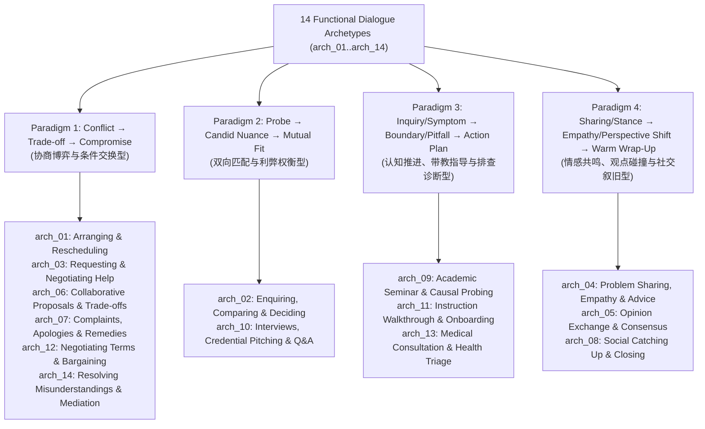

# Listening Functional Dialogue Architecture & Four Pragmatic Paradigms

> **Purpose**: This document defines the neuro-symbolic design methodology for `listening_quiz` dialogue generation and comprehension item construction across all 14 Functional Dialogue Archetypes (`arch_01`–`arch_14`, 28 register-isolated `A1_A2` & `B1_C2` trajectories). It records why full-sentence textbook chunks and uniform conflict templates fail, and establishes **Condensed Bi-Directional Spoken Patterns (`浓缩双向句型骨架`)**, **The Four Pragmatic Interaction Paradigms (`四大语用互动范式`)**, and **Dialogue-Driven Question Blueprints (`先写对话、再顺应实际剧情设问`)**.

---

## 1. Core Theoretical Foundation: Why Extracting Textbook Plotlines Turns LLMs into "Orators" (`演说家效应`)

### 1.1 The Anti-Pattern: Importing Concrete Plot Sentences from Reference Books
When a system extracts complete, plot-embedded example sentences from speaking reference books (such as COBUILD Speaking) and injects them into each turn (e.g., Turn 2: *"Have you helped out with events like this in the past?"*, Turn 3: *"How did you handle things when the schedule got tight?"*, Turn 6: *"My schedule is quite light on Fridays, so I can definitely make it."*), the LLM turns into an unnatural **"orator/speechmaker" (`演说家`)**:
- **Imported Plot Collision (`外来剧情劫持`)**: A textbook example sentence combines two distinct layers: a **reusable functional frame** (`be quite light on [day]`) and **the textbook's own concrete plot** (`Fridays`, `events like this`, `when the schedule got tight`). Injecting the whole sentence forces the LLM to stitch the textbook's plot together with the current unit's storyline and target vocabulary ($W_1 \dots W_8$).
- **Broken Turn Uptake (`话轮承接断裂`)**: Because each turn is busy reciting its assigned textbook line, neither speaker genuinely reacts to what the other just said.
- **Over-Stuffed Rhetoric**: When every single turn (`8/8`) is forced to carry both a long textbook formula and a unit target word within 15–28 words, the dialogue loses all conversational breathing room.

---

### 1.2 Established Theory 1: Conversation Analysis & The Three-Part Turn Micro-Structure (`话轮三明治微结构`)
In Conversation Analysis (Sacks, Schegloff & Jefferson) and the Lexical Approach (Lewis; Nattinger & DeCarrico's *Lexical Phrases and Language Teaching*), a natural spoken turn of 15–25 words consists of **three distinct functional layers**:

$$\underbrace{\text{1. Turn-Initial Uptake (话轮承接词)}}_{\text{1–3 words, ultra-light}} + \underbrace{\text{2. Functional Skeleton (语用句型骨架)}}_{\text{3–6 words, open slot}} + \underbrace{\text{3. Propositional Content + Unit Word ($W_k$)}}_{\text{100\% driven by the unit's own storyline}}$$

- **Example (Interview Turn 6)**:
  - $\text{[1. Uptake]}$ `"Actually,"`
  - $\text{[2. Functional Skeleton]}$ `"I'm quite tight on"`
  - $\text{[3. Story Content + Target Word]}$ `"Monday mornings because of my biology lab, but my Friday afternoons are completely open."`
- **Separation of Responsibilities**:
  - The prompt blueprint must **ONLY** supply Layer 1 (light uptake glue) and Layer 2 (**3–6 word condensed skeletons with `[slot]` placeholders**), leaving Layer 3 **100% free** for the LLM to weave a coherent story around the unit's vocabulary ($W_1 \dots W_8$).

---

### 1.3 Established Theory 2: Golden Chunk Density & Light/Heavy Turn Alternation (`黄金套话密度与轻重轮交替`)
In mature EFL/ESL instructional series (*Cambridge Touchstone / Viewpoint*, *Oxford English File*) and international listening assessments (*Cambridge B1/B2*, *IELTS Listening Section 1/3*, *TOEFL Campus Conversations*):
1. **Never Overload Every Turn (`避免句句皆大招`)**:
   - An 8-turn dialogue is structured as **4 Conversational Phases (`4 个回合`)**: `Phase 1 (Turns 1–2)`, `Phase 2 (Turns 3–4)`, `Phase 3 (Turns 5–6)`, and `Phase 4 (Turns 7–8)`.
   - Teaching 8 heavy functional idioms across 8 consecutive turns violates **Spoken Pacing & Breathing Room (`留白与呼吸感`)**.
2. **Light/Heavy Turn Alternation (`1 Core Functional Move per Phase`)**:
   - **Initiating / Probing Turns (usually Odd Turns)**: Use **lightweight conversational glue (`极简口语润滑与追问`)** (`"Oh, I see—so how did you...?"`, `"What if [X happens]?"`, `"Got it. One last thing—"`).
   - **Responding / Pivotal Turns (usually Even Turns)**: Deploy the **core 3–6 word bi-directional functional skeleton** (`1 per 2-turn Phase`, totaling **4 core functional moves per dialogue**).
3. **Bi-Directional Open Toolkit (`2–3 Short Options per Turn: Affirmative / Negative / Conditional`)**:
   - Each slot provides **2–3 condensed 3–6 word skeletons** covering both `[Affirmative / Smooth]` and `[Negative / Boundary / Pivot]` directions, explicitly framed as an **optional toolkit** rather than mandatory lines:

| Dimension | ❌ Over-Concrete Textbook Sentence | ✅ Condensed Bi-Directional Spoken Skeleton (`3–6 Words`) |
| :--- | :--- | :--- |
| **Schedule / Availability** | `"My schedule is quite light on Fridays, so I can definitely make it."` | `be quite light / tight on [day / afternoons]` <br> `keep [day] open` vs. `be tied up with [X]` |
| **Experience / Credentials** | `"Have you helped out with events like this in the past?"` | `[Affirmative] have hands-on experience in [X] / help out with [Y]` <br> `[Negative / Transferable] be new to [X], but pick up [Y] fast` |
| **Problem-Solving / Case** | `"How did you handle things when the schedule got tight?"` | `[Proactive] take the initiative to [streamline X]` <br> `[Pivot] run into a bottleneck with [X], so pivot to [Y]` |
| **Agreement / Condition** | `"Okay, it's a deal. I'll send the file by noon."` | `[Conditional] can do [A] provided that / as long as [B]` <br> `[Direct] work for me / count me in` |

---

### 1.4 Established Theory 3: Listening Assessment Signposts (`Bait → Real Key` 考点信号灯机制) & Receptive-to-Productive Transfer
In psychometric listening design (Cambridge English / IELTS / ETS), functional chunks serve two concrete pedagogical purposes:
1. **Listening Signposts (`Bait → Real Key` Information Update)**:
   - Authentic listening questions rarely test flat, uncontested statements. Instead, a 2-turn Phase introduces a **plausible initial detail (`Distractor Bait`)** and then uses a **functional skeleton as an acoustic signpost (`信号词`)** to pivot to the **actual answer (`Real Key`)**:
     - `haven't done [A] directly, but be used to [B]` $\rightarrow$ `A` is the trap; `B` is the key.
     - `be tight on [Monday], whereas [Tuesday] is wide open` $\rightarrow$ `Monday` is the trap; `Tuesday` is the key.
     - `hold true for [A], yet overlook [B]` $\rightarrow$ `A` is partial; `B` is the key factor tested.
   - Light turn-initial markers (`"Well, to be honest,..."`, `"I see what you mean, though..."`) serve as an **Acoustic Processing Cushion (`0.8 秒听觉缓冲垫`)**, alerting the listener's working memory right before the key proposition arrives.
2. **Cognitive Load & Speaking Role-Play Transfer (Miller's Law, $7 \pm 2$)**:
   - When the learner transitions from **Act I (Listening Input)** to **Act II (Speaking Output Role-Play)**, no student can memorize 8 full textbook sentences.
   - However, mastering **4 bi-directional 3–6 word skeletons** (`be light/tight on [X]`, `watch out for [X]`, `rule out [X]`) paired with the unit's vocabulary fits effortlessly within working-memory limits and enables immediate bi-directional transfer (answering either affirmatively or negatively in role-play).

---

### 1.5 Why "Dialogue-First, Content-Adaptive Question Blueprints" (`Question 松绑`) Are Essential
Because the LLM has freedom to choose between affirmative, negative, or conditional paths during dialogue generation, **question blueprints must never pre-assume a fixed plot outcome** (e.g., never hardcode *"Ask what disagreement occurs in Turn 4"* when Turn 4 in an interview is a candid story about teamwork).
- **Immutable Structural Anchors Preserved**: Each question (`Q1`–`Q5`) still locks its **Anchor Turn Span** (`Turns 1–2`, `Turns 3–4`, `Turns 5–6`, `Turns 7–8`, `Turns 1–8`), **Target Skill** (`Detail`, `Main Idea`, `Inference`), and **CRC32 Deterministic Answer Slot (`0..3`)**.
- **Content-Adaptive Question Stems & Distractor Operators**: The LLM writes the 8-turn dialogue *first*, and then formulates `Q1`–`Q5` around the **actual facts, nuances, and outcomes** present in those turns, using flexible fallacy operators (`Paraphrase Operator`, `Speaker / Role Swap`, `Opposite Detail / Polarity Flip`, `Cross-Turn Detail Mix-up`, `Condition / Availability Flip`, `Overstatement / Absolute Trap`, `Timeline / Action Mix-up`, `False Outcome Trap`).

---

## 2. The Four Pragmatic Interaction Paradigms & Scope of Conflict-Resolution

A single "Conflict $\rightarrow$ Compromise" state machine cannot govern all 14 human communicative scenarios. Pushing artificial conflict onto an interview (`arch_10`), a medical triage (`arch_13`), an onboarding tutorial (`arch_11`), or a warm catch-up (`arch_08`) produces bizarre, adversarial dialogues.

All 14 Functional Dialogue Archetypes (`arch_01`–`arch_14`) classify cleanly into **Four Pragmatic Interaction Paradigms (`四大语用互动范式`)**, each with its own conversational driving force, condensed bi-directional pattern toolkit, and question/distractor focus:



---

### 2.1 Paradigm 1: Conflict $\rightarrow$ Trade-off $\rightarrow$ Conditional Compromise (`协商博弈与条件交换型`)

- **Applicable Archetypes (6/14)**:
  - `arch_01`: Arranging, Scheduling & Rescheduling Appointments
  - `arch_03`: Requesting, Offering & Negotiating Help or Favors
  - `arch_06`: Collaborative Proposals, Action Plans & Trade-offs
  - `arch_07`: Service Complaints, Apologies & Corrective Remedies
  - `arch_12`: Negotiating Terms, Prices, Deadlines & Bargaining
  - `arch_14`: Resolving Misunderstandings, Clarifying Intent & Mediation
- **Scope of Conflict-Resolution**: **100% Native Fit**. These scenarios exist specifically because two parties face incompatible schedules, workloads, budgets, service failures, or misunderstandings and must negotiate a mutually acceptable middle ground.
- **8-Turn Trajectory**:
  - `Turns 1–2`: Initial request / proposal / complaint + immediate schedule, workload, or policy constraint.
  - `Turns 3–4`: Pushback on first alternative / diagnosis of root constraint.
  - `Turns 5–6`: **Conditional Trade-off (`If you do A, I can do B`)** or middle-ground concession.
  - `Turns 7–8`: Lock in the modified agreement + concrete next action & time anchor.
- **Condensed Bi-Directional Spoken Patterns**:
  - **Raising / Resisting**: `[Open] pencil in [day/time] / help out with [X]` vs. `[Clash] clash with [X] / be snowed under with [work] / be out of our price range / fall short of [standard]`.
  - **Conditional Bargaining**: `meet in the middle on [X]`, `split [the task / cost] down the middle`, `push [deadline] back to [time]`, `throw in [extra service] at no extra cost`, `can manage [A] provided that / as long as [you cover B]`.
  - **Misunderstanding Repair (`arch_14`)**: `get our wires crossed over [X]`, `mean to say [A] rather than [B]`, `be on the same page going forward`.
- **Question & Distractor Strategy**:
  - Focus on **Initial Proposal vs. Final Agreed Plan** (`Unadopted Early Proposal Trap`), **Why the first option failed**, and **What condition (`provided that...`) made the deal work**.

---

### 2.2 Paradigm 2: Probe $\rightarrow$ Candid Nuance $\rightarrow$ Mutual Fit (`双向匹配与利弊权衡型`)

- **Applicable Archetypes (2/14)**:
  - `arch_02`: Enquiring, Comparing Options & Making a Purchase/Enrollment Decision
  - `arch_10`: Interviews, Credential Pitching & Structured Q&A
- **Scope of Conflict-Resolution**: **No interpersonal conflict or bargaining**. Conversational depth and listening discrimination come from **Candid Nuance (`坦诚利弊/能力迁移`)** and **Practical Fit Matching (`条件适配`)**:
  - In `arch_10` (Interviews): A candidate does not argue with the interviewer; instead, they give an honest, nuanced answer (e.g., *"I haven't managed a formal budget before, but I organized our club's fundraising sale"*, or *"Monday mornings are tight because of a lab, but my Tuesday and Friday afternoons are wide open"*).
  - In `arch_02` (Enquiring & Comparing): A clerk and customer compare trade-offs between Option A (cheaper, basic hours) and Option B (slightly pricier, includes weekend access/materials).
- **8-Turn Trajectory**:
  - `Turns 1–2`: Opening inquiry / background probe + direct or transferable qualification / option overview.
  - `Turns 3–4`: Deep-dive probe (past challenge, methodology, or package comparison) + concrete example or trade-off analysis.
  - `Turns 5–6`: Practical logistics / schedule / price-tier check + candid availability or preference match.
  - `Turns 7–8`: Reverse question from candidate/customer + wrap-up & next procedural step.
- **Condensed Bi-Directional Spoken Patterns**:
  - **Experience & Fit (`arch_10`)**:
    - `[Affirmative] have hands-on experience in [X] / be in charge of [event]`
    - `[Negative / Transferable] be new to [X] / haven't done [X] directly, but be used to [related skill] and pick things up fast`
    - `[Availability] be quite light / tight on [day / afternoons]`, `keep [day] open` vs. `have a commitment on [morning]`
  - **Option Comparison (`arch_02`)**:
    - `[Pros/Cons] come with [feature A], whereas [Option B] charges extra for [X]`
    - `[Preference] lean toward [Option A] / get better value out of [Option B]`
- **Question & Distractor Strategy**:
  - Focus on **Direct vs. Transferable Experience** (`Opposite Detail / Polarity Flip`), **Which days/options work vs. don't work** (`Condition / Availability Flip`), and **Next step in the process**.

---

### 2.3 Paradigm 3: Inquiry/Symptom $\rightarrow$ Boundary/Pitfall/Differential $\rightarrow$ Action Plan (`认知推进、带教指导与排查诊断型`)

- **Applicable Archetypes (3/14)**:
  - `arch_09`: Academic Seminar, Data Interpretation & Causal Probing
  - `arch_11`: Step-by-Step Instruction Walkthrough, Lab Safety & Onboarding
  - `arch_13`: Medical Consultation, Symptom History & Health Triage
- **Scope of Conflict-Resolution**: **Zero interpersonal conflict**. Conversational tension comes from **Cognitive Nuance, Operational Pitfalls, or Differential Triage (`认知盲区、操作防错或鉴别诊断`)**:
  - In `arch_09` (Academic Seminar): Moving from a surface correlation to an overlooked confounding variable or sample boundary condition.
  - In `arch_11` (Instruction / Onboarding): Walking through a procedure, flagging a **common beginner mistake (`容易踩的坑`)**, and explaining **what to do if an exception occurs (`异常应急处理`)**.
  - In `arch_13` (Medical Triage): Checking duration/triggers, ruling out **red-flag symptoms (`鉴别排除高危症状`)**, and giving a conditional care plan (`先保守处理，若出现 X 再复诊`).
- **8-Turn Trajectory**:
  - `Turns 1–2`: Present phenomenon / task goal / primary symptom + initial observation, first step, or onset duration.
  - `Turns 3–4`: Probe deeper mechanism / critical safety precaution / red-flag symptom check (`affirmative vs. negative ruling out`).
  - `Turns 5–6`: Examine boundary condition / exception handling (`what if X goes wrong?`) / lifestyle trigger & diagnosis.
  - `Turns 7–8`: Synthesize conclusion / trainee read-back verification / treatment regimen & follow-up trigger.
- **Condensed Bi-Directional Spoken Patterns**:
  - **Academic Seminar (`arch_09`)**:
    - `[Partial Support] hold true for [group A], but break down when [condition B]`
    - `[Confounding Factor] factor in / overlook [variable X]`, `point to a link between [A] and [B] rather than direct causation`
  - **Onboarding & Instructions (`arch_11`)**:
    - `[Sequence] start by [-ing], and only then move on to [step 2]`
    - `[Pitfall Warning] watch out for [X] / make sure you don't [skip Y]`
    - `[Contingency] if [X acts up / jams], hold off on [-ing] and [do Z] instead`
  - **Medical Consultation (`arch_13`)**:
    - `[Symptom Onset] come and go since [day] / get worse when [-ing]`
    - `[Differential Check - Affirmative/Negative] rule out [fever / sharp pain] / have no sign of [X], just [mild Y]`
    - `[Care & Escalation] stick to [rest / medication] for [N days], and come back in if [symptom persists]`
- **Question & Distractor Strategy**:
  - Focus on **Causal Factor vs. Ruled-Out Factor**, **Normal Step vs. Exception/Pitfall Step**, and **Routine Care vs. Red-Flag Escalation Condition**.

---

### 2.4 Paradigm 4: Sharing/Stance $\rightarrow$ Empathy/Perspective Shift $\rightarrow$ Warm Wrap-Up (`情感共鸣、观点碰撞与社交叙旧型`)

- **Applicable Archetypes (3/14)**:
  - `arch_04`: Personal Problem Sharing, Empathy & Constructive Advice
  - `arch_05`: Opinion Exchange, Weighing Pros/Cons & Reaching Consensus
  - `arch_08`: Social Catching Up, Sharing News & Polite Pre-Closing
- **Scope of Conflict-Resolution**:
  - In `arch_04` (Advice) & `arch_05` (Opinion Exchange): Only **soft hesitation or perspective expansion** (e.g., *"I tried that, but..."* or *"I see your point on X, though from a practical angle..."*).
  - In `arch_08` (Social Catching Up): **Zero conflict of any kind**. The only turn pivot occurs at **Turn 7 (`Polite Pre-Closing Excuse`)**, where one friend signals they have to run to a class/meeting (`"I'd better get going..."`) and proposes catching up later.
- **Condensed Bi-Directional Spoken Patterns**:
  - **Problem & Advice (`arch_04`)**:
    - `[Venting] feel overwhelmed by [X] / struggle to keep up with [Y]`
    - `[Advice Uptake / Hesitation] might be worth a shot` vs. `tried [-ing], but it didn't really work out because [Z]`
  - **Opinion & Consensus (`arch_05`)**:
    - `[Nuanced Stance] see the appeal of [A], yet worry about [downside B]`
    - `[Convergence] strike a balance between [A] and [B]`
  - **Social Catch-Up & Closing (`arch_08`)**:
    - `[News & Reaction] be kept busy with [X] / go really well` vs. `take a while to get used to [Y]`
    - `[Pre-Closing Pivot] better get going / need to dash to [class/meeting] — let's catch up over [coffee/lunch] [day]`
- **Question & Distractor Strategy**:
  - Focus on **Speaker's Emotional Attitude / Recent News**, **Why a first tip was adapted (`arch_04`)**, **Shared Viewpoint (`arch_05`)**, or **Why the speaker ends the conversation & what they plan next (`arch_08`)**.

---

## 3. Summary Matrix of All 14 Archetypes

| Archetype ID | Title | Paradigm | Core Conversational Driver | Conflict / Bargaining? |
| :--- | :--- | :--- | :--- | :--- |
| **`arch_01`** | Arranging & Rescheduling | **Paradigm 1** | Schedule clash $\rightarrow$ alternative slot trade-off | ✅ Yes (Time conflict) |
| **`arch_02`** | Enquiring, Comparing & Deciding | **Paradigm 2** | Feature/price comparison $\rightarrow$ best-fit selection | ❌ No (Option trade-off) |
| **`arch_03`** | Requesting & Negotiating Help | **Paradigm 1** | Favor request $\rightarrow$ workload limit $\rightarrow$ task split | ✅ Yes (Scope condition) |
| **`arch_04`** | Problem Sharing, Empathy & Advice | **Paradigm 4** | Trouble sharing $\rightarrow$ initial tip $\rightarrow$ tailored step | ⚠️ Soft (Tip adaptation) |
| **`arch_05`** | Opinion Exchange & Consensus | **Paradigm 4** | Two perspectives $\rightarrow$ weighing pros/cons $\rightarrow$ synthesis | ⚠️ Soft (Nuance integration) |
| **`arch_06`** | Collaborative Proposals & Trade-offs | **Paradigm 1** | Project pitch $\rightarrow$ resource/time bottleneck $\rightarrow$ phased plan | ✅ Yes (Resource trade-off) |
| **`arch_07`** | Complaints, Apologies & Remedies | **Paradigm 1** | Service defect $\rightarrow$ policy limit $\rightarrow$ upgraded remedy | ✅ Yes (Remedy negotiation) |
| **`arch_08`** | Social Catching Up & Closing | **Paradigm 4** | Life update $\rightarrow$ shared interest $\rightarrow$ polite pre-closing | ❌ None (Pre-closing excuse) |
| **`arch_09`** | Academic Seminar & Causal Probing | **Paradigm 3** | Claim/data $\rightarrow$ confounding variable $\rightarrow$ refined model | ❌ None (Cognitive boundary) |
| **`arch_10`** | Interviews & Credential Pitching | **Paradigm 2** | Competency probe $\rightarrow$ direct/transferable fit $\rightarrow$ logistics | ❌ None (Candid fit nuance) |
| **`arch_11`** | Instruction Walkthrough & Onboarding | **Paradigm 3** | Step sequence $\rightarrow$ safety pitfall & contingency $\rightarrow$ checkback | ❌ None (Pitfall & exception) |
| **`arch_12`** | Negotiating Terms & Bargaining | **Paradigm 1** | Offer/quote $\rightarrow$ counter-offer $\rightarrow$ conditional concession | ✅ Yes (Price/term deal) |
| **`arch_13`** | Medical Consultation & Triage | **Paradigm 3** | Symptom onset $\rightarrow$ red-flag differential $\rightarrow$ care & trigger | ❌ None (Clinical differential) |
| **`arch_14`** | Resolving Misunderstandings | **Paradigm 1** | Crossed wires $\rightarrow$ intent clarification $\rightarrow$ shared protocol | ✅ Yes (Expectation alignment) |

---

## 4. Empirical Verification (`arch_10` Before vs. After Refactoring)

### 4.1 Before Refactoring (Over-Concrete Sentences + Rigid Conflict Questions)
- **Symptom**: In `20261102_163605_533_test_listening_arch_10_a2_inf_sc01_JSON_MODE.log`, Turn 2 asked `"Have you helped out with events like this in the past?"`, Turn 3 abruptly jumped to `"How did you handle things when the schedule got tight?"`, and Turn 6 recited `"My schedule is quite light on Fridays, so I can definitely make it."` regardless of the previous turn's context.
- **Root Cause**: Full-sentence textbook chunks forced sentence-stitching, while rigid conflict question prompts forced unnatural twists.

### 4.2 After Refactoring (Condensed Bi-Directional Patterns + Dialogue-Driven Questions)
- **Condensed Pattern Toolkit**:
  - `be quite light / tight on [day / afternoons]`
  - `[Affirmative] help out with / be in charge of [event / task]` vs. `[Negative / Transferable] haven't done [X] before, but be used to [related task] and pick things up quickly`
- **Live Output (`arch_10_a2_inf_sc01` & `arch_10_b1p_form_sc01`)**:
  - **A2 (`36.99s`, 0 retries)**: Candidate naturally links photography hobby to the club helper role, explains how they fixed a rain delay at a school music show, and contrasts busy Monday mornings with light Tuesday/Friday afternoons.
  - **B2 (`53.06s`, 0 retries, 0 Code Gate warnings)**: Candidate connects cross-departmental data tracking to the project coordinator role, illustrates resolving a two-week reporting bottleneck via a shared tracking template, and aligns on a hybrid onboarding schedule.

---

## 5. Forced Archetype Specification (CLI & Frontmatter)

To support scripted curriculum compilation, teacher customization, and multi-variant evaluation, the listening pipeline supports locking any of the 14 communicative archetypes deterministically via CLI or Markdown Frontmatter.

### 5.1 Invocation Methods

1. **CLI Parameter (`--archetype, -a`)**:
   ```bash
   # Force by index number (1–14):
   lexis quiz Book_1_Unit_1_Section_A -t listening -a 4

   # Force by canonical ID:
   lexis quiz Book_1_Unit_1_Section_A -t listening -a arch_04_problem_sharing_empathy_and_advice

   # Force by semantic keyword alias:
   lexis quiz Book_1_Unit_1_Section_A -t listening -a advice
   lexis quiz Book_4_Unit_6_Section_A -t listening -a seminar
   lexis quiz Book_2_Unit_3_Section_A -t listening -a complaint
   ```

2. **Unit Source Markdown Frontmatter (`sources/<Unit>.md`)**:
   ```yaml
   ---
   title: "Book 1 Unit 1 Section A"
   listening_archetype: "advice"   # or 4, or arch_04
   ---
   ```

### 5.2 Resolution Priority Cascade
1. **CLI Flag (`--archetype / -a`)**: Highest precedence, overrides all frontmatter.
2. **Source Frontmatter (`listening_archetype: "..."`)**: Used when CLI flag is omitted.
3. **Deterministic Topic Matcher (`CRC32` Tie-Breaking)**: Default when no archetype is specified; scores thematic tokens against archetype keywords and uses deterministic tie-breaking.

### 5.3 Semantic Alias Mapping Table

| Input Number / Aliases | Canonical Archetype ID | Communicative Function |
| :--- | :--- | :--- |
| `1`, `arch_01`, `arranging`, `reschedule`, `appointment` | `arch_01_arranging_and_rescheduling` | Making Arrangements & Rescheduling |
| `2`, `arch_02`, `options`, `decision`, `compare`, `enquiry` | `arch_02_enquiring_comparing_and_deciding` | Enquiring, Comparing & Deciding |
| `3`, `arch_03`, `help`, `request`, `requesting` | `arch_03_requesting_and_negotiating_help` | Requesting & Negotiating Help |
| `4`, `arch_04`, `advice`, `problem`, `empathy`, `trouble` | `arch_04_problem_sharing_empathy_and_advice` | Problem Sharing, Empathy & Advice |
| `5`, `arch_05`, `opinion`, `consensus`, `debate`, `views` | `arch_05_opinion_exchange_and_consensus` | Opinion Exchange & Consensus |
| `6`, `arch_06`, `proposal`, `proposals`, `collaboration`, `planning` | `arch_06_collaborative_proposals_and_tradeoffs` | Collaborative Proposals & Trade-offs |
| `7`, `arch_07`, `complaint`, `complaints`, `remedy`, `apology`, `feedback` | `arch_07_complaints_apologies_and_remedies` | Complaints, Apologies & Remedies |
| `8`, `arch_08`, `social`, `catching_up`, `icebreak`, `closing` | `arch_08_social_catching_up_and_closing` | Social Catching Up & Closing |
| `9`, `arch_09`, `seminar`, `academic`, `causal`, `probing`, `hypothesis` | `arch_09_academic_seminar_and_causal_probing` | Academic Seminar & Causal Probing |
| `10`, `arch_10`, `interview`, `interviews`, `pitch`, `pitching` | `arch_10_interviews_and_credential_pitching` | Interviews & Credential Pitching |
| `11`, `arch_11`, `instruction`, `onboarding`, `walkthrough` | `arch_11_instruction_walkthrough_and_onboarding` | Instruction Walkthrough & Onboarding |
| `12`, `arch_12`, `negotiate`, `negotiation`, `bargain`, `compromise` | `arch_12_negotiating_terms_and_compromise` | Negotiating Terms & Compromise |
| `13`, `arch_13`, `medical`, `health`, `clinic`, `doctor`, `symptoms` | `arch_13_medical_consultation_and_health_triage` | Medical Consultation & Health Triage |
| `14`, `arch_14`, `misunderstanding`, `mediation`, `clarification` | `arch_14_resolving_misunderstandings_and_mediation` | Resolving Misunderstandings & Mediation |

---

## 6. Forced Scenario Specification & Dashboard Cascading Dropdown

Beyond archetypes, teachers and curriculum designers can force specific **everyday scenarios** (30 concrete scenarios across the 14 archetypes) via CLI, Markdown Frontmatter, or the Dashboard Web UI.

### 6.1 Invocation Methods
1. **CLI Flag (`--scenario, -s`)**:
   ```bash
   # Force specific scenario ID:
   lexis quiz Book_1_Unit_1_Section_A -t listening -s arch_01_a2_inf_sc01

   # Force by setting keyword (auto-locks archetype and trajectory):
   lexis quiz Book_1_Unit_1_Section_A -t listening -s weekend
   lexis quiz Book_4_Unit_6_Section_A -t listening -s clinic
   ```

2. **Unit Source Markdown Frontmatter (`sources/<Unit>.md`)**:
   ```yaml
   ---
   title: "Book 1 Unit 1 Section A"
   listening_archetype: "arch_01_arranging_and_rescheduling"
   listening_scenario: "arch_01_a2_inf_sc01"
   ---
   ```

3. **Dashboard Web UI Two-Tier Cascading Dropdown**:
   - **Level 1 (Listening Archetype)**: Pure English list of 14 communicative archetypes (`Auto`, `1. Arranging & Rescheduling`, ..., `14. Resolving Misunderstandings`).
   - **Level 2 (Listening Scenario)**: Dynamically populates based on Level 1 selection (`Auto (Setting-Adaptive)`, `[Informal] ...`, `[Formal] ...`). If Archetype is set to `Auto`, Scenario defaults to `Auto` and is disabled.

---

## 7. Dual-Track SLA Routing & Academic Concretization Architecture

To reconcile the tension between advanced unit reading themes (e.g. *Market Research, Epistemology, Global Supply Chains*) and authentic spoken language acquisition, the listening generator enforces a strict cognitive dual-track separation based on Cummins' BICS vs. CALP framework.

### 7.1 A1–B1 vs. B2–C1 Dual-Track Automatic Routing

When trajectory selection is not explicitly overridden by `--scenario`, the pipeline resolves the CEFR band automatically:
- **A1–B1 Units (`A1_A2` Trajectory Band)**: Targets everyday interpersonal communication (BICS). Maps to campus life, service desks, travel, borrowing, casual arrangements, and everyday social problem-solving.
- **B2–C1 Units (`B1_C2` Trajectory Band)**: Targets professional and academic communicative competence (CALP). Maps to academic seminars, project consultations, advisor meetings, and team compromise negotiations.

### 7.2 Thematic Physical Shelling for A1–A2

When an A1–A2 trajectory is executed for a unit featuring an abstract or high-level academic/business reading passage, the generator applies **Thematic Physical Shelling**:
- The reading topic functions **strictly as a physical backdrop or nominal setting** (e.g., *"Market Research Building"*, *"Room 302 of the Economics Dept"*, *"Signboard for the Consumer Trends Lecture"*).
- The topic is strictly banned from invading daily speech acts. Interpersonal dialogue turns must remain 100% authentic, everyday communicative English (e.g., *asking for directions to a room, borrowing a charger, checking room opening hours*).

### 7.3 B2–C1 Academic Concretization & Comprehensible Input

Academic discussions (e.g., Archetype 9 *Academic Seminar*, Archetype 4 *Advisor Consultation*, Archetype 6 *Project Trade-offs*) frequently fail SLA standards if allowed to drift into abstract philosophical essays. The generator enforces four psycholinguistic grounding rules:

1. **Tangible Artifact Anchoring**:
   - Every high-level academic or methodological dispute must ground in a concrete project artifact:
     - *Slide #3 of the deck*, *table on page 14*, *sample size of 30 undergraduates*, *2,000-word limit*, *audio recorder battery failure during Tuesday's interview*.
   - Abstract assertions (*"Our methodological paradigm exhibits epistemological dissonance"*) are completely replaced with concrete student-advisor friction (*"If we interview 30 people instead of 10, how do we transcribe that before Friday's deadline?"*).
2. **Conversational vs. Essay Markers**:
   - Explicitly bans written essay transitions: `Furthermore`, `Moreover`, `In conclusion`, `Consequently`.
   - Requires natural spoken signposts: `Hang on`, `The real snag is...`, `To be fair...`, `What if we...`, `That's one way to look at it, but...`.
3. **Turn Length & Working Memory Ceiling**:
   - Single turns are capped at **18–25 words** (hard maximum 35 words).
   - Long monologues overwhelm auditory working memory; arguments must be broken into interactive Light/Heavy turn alternations with active listener backchanneling (`Right`, `Fair point`, `I see what you mean`).
4. **Cambridge/IELTS Signposted Distractor Traps (`Bait → Real Key`)**:
   - Explicitly requires spoken repair and topic redirection (*"I initially planned to survey 50 students, but Dr. Evans capped it at 20"*), testing comprehension of spoken updates rather than passive keyword matching.


