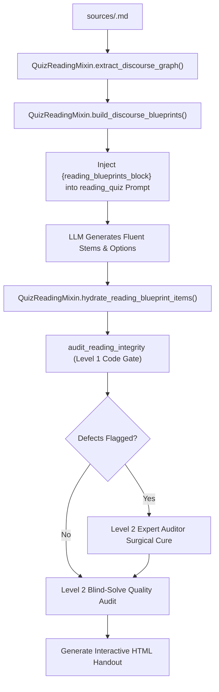

# Reading Comprehension & Discourse Architecture

> **Purpose**: Single source of truth for the symbolic reading comprehension engine in Lexis Wiki. Defines the discourse graph extraction, rhetorical span anchoring, psychometric distractor fallacy operators, single-step inference entailment, and CEFR-tiered blueprint pipeline.

---

## 1. Architectural Philosophy: Why Pure LLM Reading Quizzes Fail

In traditional LLM-generated reading assessments, language models consistently exhibit four fatal psychometric flaws:
1. **Superficial Text-Matching & Lexical Leakage**: The correct option borrows 80%+ verbatim phrasing from a single sentence, turning reading comprehension into a trivial visual string-matching puzzle.
2. **Wild Speculation in Inference Questions**: When asked for "implications", LLMs extrapolate multi-step real-world speculation or commonsense stereotypes not warranted by the text.
3. **Double Keys & Ambiguous Distractors**: Distractors are drafted as vague falsehoods rather than principled cognitive traps, often colliding with other parts of the text or being accidentally true.
4. **Lack of CEFR Difficulty Control**: Stems and options oscillate randomly between A1 baby talk and C2 obscure vocabulary without pedagogical calibration.

### The Neuro-Symbolic Solution
Lexis Wiki enforces a strict separation:
- **Symbolic Layer (`QuizReadingMixin` in `librarian/linguistics_core/quiz_reading.py`)**: Computes the passage discourse graph, selects rhetorical anchors, binds exact skills, prescribes standardized question stems, and assigns 3 mutually orthogonal **Distractor Fallacy Operators** per question.
- **LLM Layer (`gemma4:12b` / `qwen3.8:27b`)**: Acts strictly as a fluent paraphrase generator executing the symbolic micro-task blueprint.
- **Invariant Gate Layer (`audit_reading_integrity` in `quiz_integrity_gates.py`)**: Programmatically verifies 4-option cardinality, single correct key, CEFR lexical ceiling, and enforces a **3-gram Verbatim Lexical Leakage Gate** ensuring options cannot be solved by visual string matching.

---

## 2. Discourse Graph & Rhetorical Relations

The symbolic engine parses the source passage into an interconnected discourse graph via paragraph indexing, sentence tokenization, and `spaCy` transition marker matching.

```
                  ┌──────────────────────────────┐
                  │    Passage Discourse Graph   │
                  └──────────────┬───────────────┘
                                 │
     ┌───────────────────────────┼───────────────────────────┐
     ▼                           ▼                           ▼
[Global Core Claim]    [Paragraph Transitions]     [Sentence Clusters]
(Title, Intro, Outro)  (However, Therefore, While) (Causal / Contrast Spans)
```

### The 6 Reading Skills (`DiscourseRelationType`)

| Skill Enum | Target Cognitive Skill | Pedagogical Function | Standard Stem Template |
| :--- | :--- | :--- | :--- |
| `MACRO_GIST` | Global theme / central purpose | Synthesizes overarching thesis, filtering out subordinate paragraph details. | `"What is the main purpose of this text?"` or `"Which statement best summarizes the author's primary thesis?"` |
| `CAUSAL_CHAIN` | Cause-and-effect relationship | Tests understanding of prerequisite conditions, mechanisms, and outcomes. | `"According to Paragraph X, what directly caused [Cause]?"` or `"What is the primary consequence of [Mechanism]?"` |
| `RHETORICAL_CONTRAST` | Adversative comparison | Distinguishes opposing viewpoints, historical vs. modern states, or nuanced differences. | `"How does [Subject A] differ fundamentally from [Subject B]?"` |
| `FACTUAL_MECHANISM` | Detailed operational procedure | Assesses comprehension of factual workflows, functions, or specific definitions. | `"In Paragraph X, how does [Process] function?"` |
| `MODALITY_HEDGING` | Stance, certainty, and scope | Discriminates between definitive claims (`proves`) vs. hedged hypotheses (`suggests`, `may indicate`). | `"What is the author's attitude or degree of certainty regarding [Claim]?"` |
| `PRAGMATIC_INFERENCE` | Single-step logical entailment | Tests unstated logical implications and presuppositions grounded strictly in text premises. | `"What can be logically inferred from Paragraph X regarding [Subject]?"` |

---

## 3. The 10 Distractor Fallacy Operators

Instead of asking the LLM to invent random wrong answers, each distractor is assigned a deterministic fallacy operator. The operators are calibrated across three CEFR tiers:

```
Difficulty Tiers:
├── FOUNDATIONAL (A1 - A2)
│   ├── TRUE_BUT_IRRELEVANT    (True fact from another paragraph, irrelevant to stem)
│   ├── OPPOSITE_FACT          (Direct factual negation)
│   ├── EXTREME_WORD           (Absolutes: always, never, only, completely)
│   └── SAME_PARA_MISMATCH     (Same paragraph entity/action swapped)
├── INTERMEDIATE (B1 - B2)
│   ├── CAUSAL_REVERSAL        (Flips cause and effect: A caused B -> B caused A)
│   ├── POLARITY_INVERSION     (Flips rhetorical polarity or sentiment)
│   └── MODALITY_ESCALATION    (Converts hedged probability into definitive certainty)
└── ADVANCED (C1 - C2)
    ├── EXPLICIT_RESTATEMENT   (Directly stated explicit fact presented as an 'implication')
    ├── OVER_EXTENSION         (Plausible real-world speculation beyond textual warrant)
    └── REVERSE_ENTAILMENT     (Fallacy of affirming the consequent: P -> Q /= Q -> P)
```

### Detailed Operator Catalog

#### 1. `TRUE_BUT_IRRELEVANT`
- **Trap**: Extracts a factually accurate statement from a different section of the passage that does not answer the specific question asked.
- **Target Vulnerability**: Catches students who scan for familiar words without checking question relevance.

#### 2. `CAUSAL_REVERSAL`
- **Trap**: Inverts the arrow of causation ($A \to B$ becomes $B \to A$).
- **Target Vulnerability**: Catches students who recognize related entities but misunderstand their directional relationship.

#### 3. `POLARITY_INVERSION`
- **Trap**: Reverses the author's affirmative/negative stance or sentiment while preserving technical terminology.
- **Target Vulnerability**: Tests syntactically complex negations, double negatives, and subtle dismissals.

#### 4. `MODALITY_ESCALATION`
- **Trap**: Escalates tentative hypothesis markers (`may suggest`, `indicates a potential link`) into dogmatic absolutes (`definitely proves`, `guarantees`).
- **Target Vulnerability**: Key academic reading skill in TOEFL/IELTS/GRE.

#### 5. `OPPOSITE_FACT`
- **Trap**: Stems from explicit antonyms or direct factual reversals of the target sentence.
- **Target Vulnerability**: Foundational test of sentence-level comprehension.

#### 6. `EXTREME_WORD`
- **Trap**: Uses restrictive quantifiers (`only`, `solely`, `exclusively`, `every`) not warranted by the source passage.
- **Target Vulnerability**: Trains critical reading against over-generalizations.

#### 7. `SAME_PARA_MISMATCH`
- **Trap**: Binds an action from line 1 of a paragraph to an entity from line 4 of the same paragraph.
- **Target Vulnerability**: Traps skimming readers who rely on paragraph-level keyword clustering.

#### 8. `EXPLICIT_RESTATEMENT` (Inference Trap)
- **Trap**: In an inference question, provides a statement that is **explicitly stated word-for-word in the text**.
- **Psychometric Value**: The psychometric definition of inference requires deductive reasoning from unstated premises ($P \to Q$). Superficial test-takers pick the verbatim fact because it is "obviously true", failing to recognize that an explicit statement is not an inference.

#### 9. `OVER_EXTENSION` (Inference Trap)
- **Trap**: Extrapolates a multi-step real-world speculation that sounds intuitively reasonable but is unsupported by the text.
- **Target Vulnerability**: Traps students who rely on outside commonsense rather than strictly bounded textual premises.

#### 10. `REVERSE_ENTAILMENT` (Inference Trap)
- **Trap**: Commits the logical fallacy of affirming the consequent or denying the antecedent (e.g. if the text states "All advanced sensors require calibration", the trap claims "Any calibrated instrument is an advanced sensor").
- **Target Vulnerability**: Rigorous discriminator for high-tier academic assessments.

---

## 4. Inference & Implication Architecture

### Definition of Pragmatic Inference
In Lexis Wiki, an inference item is strictly defined as:
$$\text{Passage Premise } P \implies \text{Target Key } Q \quad (Q \notin \text{Verbatim Passage})$$

A valid inference must satisfy:
1. **Single-Step Entailment**: $Q$ is a direct deductive necessity or pragmatic presupposition of $P$.
2. **Non-Trivial Paraphrase**: $Q$ does not reuse verbatim clauses from $P$.
3. **No Speculative Leaps**: $Q$ requires no external empirical premises outside the text.

### The Tripartite Inference Distractor Blueprint
Every `PRAGMATIC_INFERENCE` item is pre-configured with the following three distractors:
1. `distractor_1`: `EXPLICIT_RESTATEMENT` (Directly stated fact; traps superficial string-matchers).
2. `distractor_2`: `OVER_EXTENSION` (Speculative over-reach; traps common-sense extrapolators).
3. `distractor_3`: `REVERSE_ENTAILMENT` or `CAUSAL_REVERSAL` (Inverted logical necessity).

---

## 5. Lexical Leakage Guard & Level 1 Deterministic Code Gate

To eliminate trivial string matching, `audit_reading_integrity` in `librarian/processor_core/quiz_integrity_gates.py` checks:
1. **3-Gram Verbatim Leakage Gate**:
   - Extracts all contiguous 3-grams from the source passage.
   - Calculates the proportion of 3-grams in the correct option that appear verbatim in the passage.
   - If verbatim overlap exceeds $45\%$, flags a **Lexical Leakage Defect** and penalizes the item by $-25.0$ points, triggering Level 2 surgical cure or rewriting.
2. **Single Correct Key & Option Cardinality**: Exactly 4 options; `correct_answer_index` $\in \{0, 1, 2, 3\}$.
3. **CEFR Lexical Ceiling**: Checks options against target passage CEFR ceiling via `cefrpy`.
4. **Blueprint Invariant Preservation**: Preserves assigned category, anchor paragraph, and question stem through option shuffling.

---

## 6. End-to-End Execution Flow



---

## 7. Verification & Benchmark Units

The reading engine has been verified across foundational and advanced benchmark texts:
- **`Book_1_Unit_1_Passage_A`** (Foundational A2/B1): 6 items, 100% Level 1 Code Gate pass, 0 double keys.
- **`Book_1_Unit_2_Passage_A`** (Volunteer Appreciation, A2): 6 items including `PRAGMATIC_INFERENCE`, 100% blind-solve accuracy by Level 2 expert auditor (`qwen3.8:27b`), composite quality score 91.0/100.
