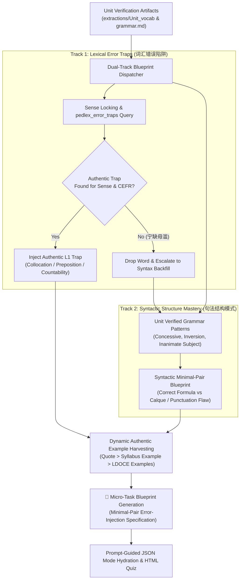
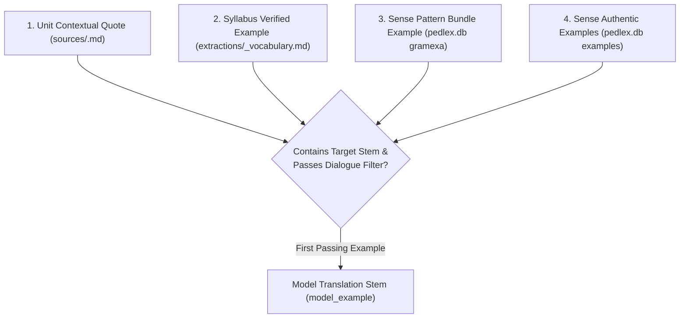

# Translation Architecture: Sense-First Authentic Error Traps & Minimal-Pair Assessment

> **Purpose**: Technical specification and psychometric standard for the Lexis Wiki **Anchored Translation Quiz Blueprint Engine** (`librarian/linguistics_core/quiz_translation.py`). Implements a contrastive Second Language Acquisition (SLA) assessment architecture featuring **Sense-First CEFR-Gated Error Traps, Zero-Synthetic Distractor Invariants, Dynamic Corpus Stem Harvesting, Dialogue Speech-Act Filtering, and Graceful Syntactic Backfill**.

---

## 1. Pedagogical & SLA Theoretical Foundations

### 1.1 Contrastive SLA & L1 Negative Transfer
In Second Language Acquisition (SLA), translation is not evaluated as literal dictionary-substitution, but as **Interlingual Structural Alignment & Pragmatic Restructuring** (Lado, 1957; Ellis, 1994; Odlin, 1989):
- **Delexical Calques & False Collocations**: Chinese-speaking learners systematically transfer L1 verb-noun combinations into English (e.g., using "*learn knowledge*" or "*make suggestion*" instead of "*acquire/gain knowledge*" or "*make a suggestion*").
- **Boundary & Aspect Mismatches**: Prepositional and aspectual frames frequently deviate from Chinese direct translations (e.g., translating "在24小时之内" as "*during 24 hours*" or "*inside 24 hours*" instead of "*within 24 hours*").
- **Structural Calques & Concessive Run-ons**: Syntactic negative transfer (e.g., pairing "*Although... but...*", comma splices, or fronting instrumentals "*With [Tool], people can...*" instead of inanimate subjects).

### 1.2 The Flaws of Legacy Translation Generators
Traditional LLM translation question generation suffers from four fatal defects:
1. **Static Sentence Fatigue ("老题库硬套")**: Forcing fixed example sentences from an external dictionary or catalog regardless of the unit's actual text or CEFR level.
2. **Synthetic / Hallucinated Error Inventions ("凭空捏造错误")**: Inventing artificial "wrong prepositions" or arbitrary grammatical violations not documented in SLA empirical error corpora.
3. **CEFR Level Inversion ("低级错误测高级学生")**: Testing elementary A2-level preposition errors (like *during* vs *within*) on C1-level academic texts, or vice versa.
4. **Conversational Speech-Act Leakage**: Incongruously injecting conversational spoken formulas (e.g., "*Excuse me?*", "*Thank you!*", "*What's the matter?*") into formal expository sentence translation tasks.

---

## 2. Dual-Track Minimal-Pair Architecture

The Lexis Wiki Translation Engine balances two complementary SLA dimensions:



### 2.1 The Minimal-Pair Psychometric Paradigm
Every translation assessment item is constructed around a **Single-Variable Minimal Pair**:
- **Key (Option A)**: 100% natural, idiomatic standard English adhering to the target lexical valency or grammatical formula.
- **Primary Distractor (Option B)**: The high-discrimination **Minimal Pair Trap**, identical to the Key in vocabulary, tense, and rhetorical structure *except* for injecting the exact target L1 negative transfer flaw.
- **Secondary Distractors (Options C & D)**: Plausible structural, aspectual, or voice variations that force learners to analyze both global grammar and local lexical precision.

---

## 3. Sense-First & CEFR-Gated Error Trap Resolution

The core algorithm is encapsulated in `QuizTranslationMixin._resolve_target_frame_and_error_trap`:

### 3.1 Three-Gate Candidate Resolution
1. **Gate 1 — Contextual Sense Locking**:
   - Queries `pedlex_error_traps` in `pedlex.db` filtering strictly by POS, lemma, and locked `sense_idx`.
   - Ensures an error trap for *mean* (verb "intend", sense 1) is never accidentally applied to *mean* (adjective "unkind", sense 3).
2. **Gate 2 — Context Keyword Alignment**:
   - Fallback catalog items (`L1_FALSE_COLLOCATION_CATALOG`) are verified against `valid_sense_keywords`.
   - The word's definition or quote must contain matching contextual semantic cues (e.g., `within` requires temporal keywords like *time*, *hour*, *duration* to prevent testing spatial *within* against temporal calques).
3. **Gate 3 — CEFR Level Calibration**:
   - Error traps specify permissible CEFR bands (`cefr_levels: ["A1", "A2", "B1"]` or `["B2", "C1", "C2"]`).
   - Prevents testing elementary A-level preposition giveaways on advanced B2/C1 units.

### 3.2 The Zero-Synthetic Invariant ("宁缺毋滥")
> **Architectural Rule**: *If a vocabulary item lacks an authentic, empirical error trap in `pedlex_error_traps` or `L1_FALSE_COLLOCATION_CATALOG` matching its locked sense and CEFR level, it must be dropped immediately. The engine is strictly prohibited from inventing synthetic error traps.*

No arbitrary prepositions or invented Chinglish calques are ever manufactured. When vocabulary candidates run out, the engine invokes **Graceful Syntactic Backfill**.

---

## 4. Graceful Syntactic Backfill (弹性退避机制)

When a unit's vocabulary items lack empirical error traps (e.g., concrete nouns like *carpet*, *wheel*, or monosemous words without common L1 transfer errors), the blueprint engine automatically and seamlessly reallocates the quota to verified **Grammar Structure Patterns** (`grammar_items`).

```python
# Dynamic Quota Allocation & Backfilling in quiz_translation.py
allocated_lex = min(len(valid_vocab_candidates), target_count // 2)
allocated_syn = target_count - allocated_lex

# If verified lexical traps are insufficient, 100% of remaining slots backfill to syntax
if allocated_lex < target_count // 2 and grammar_items:
    allocated_syn = target_count - allocated_lex
```

### 4.1 Verification Guarantee
In `tests/test_anchored_translation.py:test_translation_fallback_to_syntax_when_no_authentic_traps`:
- When tested with words lacking authentic traps (*carpet*, *wheel*), zero synthetic traps are generated.
- No external dictionary words (*knowledge*, *within*) are illicitly injected.
- The blueprint successfully emits 4 syntactic minimal-pair items based on the unit's actual grammar patterns (*Concessive Clauses*, *Inanimate Causation*).

---

## 5. Dynamic Authentic Stem Harvesting

To permanently eliminate template repetition ("不变的例句太枯燥"), stems are harvested dynamically from four authentic compartments:



### 5.1 Dialogue Speech-Act Filtering
Conversational dialogic questions and deictic formulas are strictly banned from expository sentence translation via `_dialogic_deictic_re`:
- Filtered patterns: Greetings, deictic interjections, short rhetorical questions (`"Excuse me?"`, `"Thank you!"`, `"What's the matter?"`, `"How are you?"`).
- Any candidate containing conversational question marks (`?`) or speech-act formulas is bypassed in favor of a full declarative proposition.

---

## 6. Micro-Task Specification for LLM Hydration

The symbolic engine outputs complete blueprints with pre-computed constraints, eliminating LLM hallucination:

```text
🎯 Micro-Task for LLM:
Focus: Lexical Error Trap (Target Keyword: 'accuse')
Required Frame: accuse [person] of [doing something]
Error Trap to Inject (Option B): *accuse [person] for [doing something]* (L1 false preposition)
Model Sentence: They accused him of taking bribes.
Chinese Prompt: 他们指控他收受贿赂。

Requirements:
1. Option A (Key): Must strictly use 'accuse someone of doing something'.
2. Option B (Minimal Pair): Must use '*accuse someone for doing something*'.
3. Options C & D: Plausible grammatical or structural variations.
4. Single-Variable Invariant: All options must preserve identical propositional meaning.
```

---

## 7. Automated Test Suite & Code Gate Verification

All translation blueprints and hydration logic are enforced by automated test suites in `tests/test_anchored_translation.py`:
- `test_minimal_pair_distractor_injection`: Verifies single-point error injection between Key and Distractor.
- `test_translation_fallback_to_syntax_when_no_authentic_traps`: Verifies zero-synthetic generation and 100% smooth syntactic backfill.
- `test_filter_dialogic_speech_acts`: Verifies speech-act question exclusion in formal translation stems.
- `test_step3_zero_redundancy_schema_and_hydration`: Verifies single-pass Prompt-Guided JSON hydration and zero token redundancy.

---

## 8. Summary of Architectural Achievements

| Dimension | Legacy Method | Lexis Wiki Architecture |
| :--- | :--- | :--- |
| **Error Source** | Arbitrary LLM hallucination / hardcoded static lists. | **`pedlex_error_traps` + Context Sense + CEFR Calibration**. |
| **Example Stems** | Repetitive fixed template sentences. | **4-tier authentic dynamic harvesting (Quote > Syllabus > LDOCE)**. |
| **Deficiency Handling** | Fabricating fake errors or forcing off-unit words. | **"宁缺毋滥" + 100% Graceful Syntactic Backfill**. |
| **Speech-Act Isolation** | Spoken greetings and questions leak into translation. | **Strict regex speech-act & deictic formula filtering**. |
| **Discrimination** | Vague semantic paraphrase differences. | **Single-variable SLA Minimal-Pair psychometric contrast**. |
